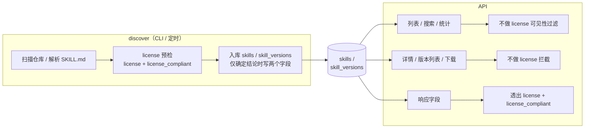
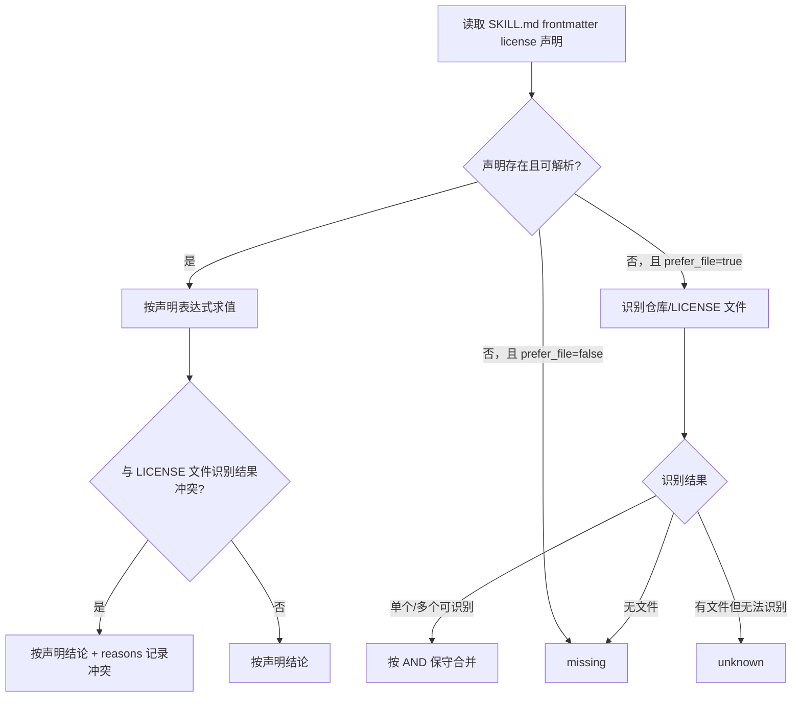

# Skill License 类型与合规标记设计

## 一、背景与范围

平台需要对外分发第三方仓库中的 Skill，需要记录每个 Skill 实际使用的
license 类型与合规结论。早期方案在入库阶段直接删除 license 不合规的 Skill，
存在两个问题：

1. **不可追溯**：删除后无法统计、无法向作者反馈、无法复检；
2. **判定成本耦合入库**：每轮都要读取仓库 license 文件，准入清单更新后存量
   数据不会重新判定。

本方案改为**只标记、不删除**，在 `skills` / `skill_versions` 上维护两个字段：

- `license`：本次判定得到的**具体 license 类型**（归一化 SPDX 表达式）；
- `license_compliant`：三态合规结论（`1` / `0` / `NULL`）。

当前实现范围（按代码检视意见收敛）：

- **保留**：字段定义与迁移、license 判定引擎、discover 扫描内的 license 预检、
  字段写入与 API 透出；
- **已移除**：基于 `license` / `license_compliant` 的可见性过滤，以及 license
  定时/全量复核任务（`src/jobs/license_check.py` 及 worker 中的调度接线）；
- **后续规划**：数据可见性限制、存量数据全量复核、缓存自动回收，由其他开发者
  统一规划实现。

### 设计目标

| 目标 | 说明 |
|------|------|
| 不删除 | 不合规数据保留在库中，只记录结论 |
| 可区分 | 「未检查」与「检查后不合规」必须是两种状态，不能混为一谈 |
| 类型可见 | 除三态结论外，还要记录具体的 license 类型（SPDX 表达式） |
| 声明优先 | 以 SKILL.md 的 `license` 声明为准，LICENSE 文件仅作回退 |
| 失败不误判 | 基础设施错误（清单不可用、仓库不可读）不得写成「不合规」 |
| 解耦 | 字段写入不阻塞 discover 主流程，也不决定 Skill 是否入库 |

---

## 二、总体架构



关键边界：

- discover **会 import** license 判定模块：每轮惰性构建一个 `LicenseChecker`，
  对本次构建的 record 做预检，只写 `license` / `license_compliant`；不跳过、
  不删除任何 skill。
- API 只读取字段做展示，**不做**任何可见性判断；字段值为 `0` 的 Skill 仍会
  出现在列表、搜索、详情与下载中。
- license 定时/全量复核任务已移除，discover 扫描是当前唯一的字段写入路径。

---

## 三、数据模型

### 3.1 字段定义

`skills` 与 `skill_versions` 各新增两个字段，分别由
`015_add_license_compliant.py` 与 `017_add_skill_license.py` 引入：

```sql
-- 015：三态合规结论
ALTER TABLE skills          ADD COLUMN IF NOT EXISTS license_compliant SMALLINT NULL;
ALTER TABLE skill_versions  ADD COLUMN IF NOT EXISTS license_compliant SMALLINT NULL;
ALTER TABLE skills          ADD CONSTRAINT ck_skills_license_compliant
    CHECK (license_compliant IN (0, 1));
ALTER TABLE skill_versions  ADD CONSTRAINT ck_skill_versions_license_compliant
    CHECK (license_compliant IN (0, 1));

-- 016：具体 license 类型（归一化 SPDX 表达式）
ALTER TABLE skills          ADD COLUMN IF NOT EXISTS license TEXT NULL;
ALTER TABLE skill_versions  ADD COLUMN IF NOT EXISTS license TEXT NULL;
```

### 3.2 `license` 语义

`license` 保存判定引擎 `LicenseVerdict.expression` 归一化后的结果：

| 判定输入 | `license` 取值 |
|---|---|
| 声明可解析（`MIT`、`MIT AND Apache-2.0`） | 声明表达式本身 |
| 无声明、由 LICENSE 文件识别 | 识别结果（多个文件按 AND 拼接） |
| `missing`（无声明且无文件） | `NULL` |
| `unknown` 但声明非空 | 保留原始声明，便于回溯“为什么判成不合规” |
| `error`（仓库不可读等） | `NULL`，且本轮**不写库** |

`license` 与 `license_compliant` 必须来自**同一次判定**：`runtime.py` 中
`verdict_to_license(verdict)` 与 `verdict_to_flag(verdict.status)` 共用同一个
`LicenseVerdict`，避免出现“类型是 A、结论按 B 算”的错配。

### 3.3 三态语义

| 取值 | 含义 | 产生条件 |
|------|------|----------|
| `1` | 已检查且合规 | 判定状态 `allowed` |
| `0` | 已检查但不合规 | `restricted` / `black` / `missing` / `unknown` |
| `NULL` | 尚未得到确定结论 | 新入库尚未轮到扫描；或判定始终失败、从未写入过 1/0 |

> 判定失败**不是**一种独立状态：本轮失败的已有记录保留数据库原值
> （`license` 与 `license_compliant` 都保留），不会统一改成 `NULL`。

### 3.4 设计取舍

**为什么 `license_compliant` 用 `SMALLINT NULL` 而不是 `BOOLEAN`**

`BOOLEAN` 只有两态，无法表达「未检查」。若用 `BOOLEAN NOT NULL DEFAULT false`，
则所有新入库数据在预检之前都会被误判为不合规。

**为什么 `license` 用 `TEXT` 而不是 `VARCHAR(n)`**

声明可能是列表或复合表达式（如 `MIT AND Apache-2.0`），长度不可预估；
`TEXT` 避免截断或写入失败，也不需要为不同仓库调整长度上限。

**为什么 `CHECK (col IN (0,1))` 允许 NULL**

SQL 的 CHECK 约束对 NULL 求值为 UNKNOWN，视为通过。因此该约束只拦截
`2`、`-1` 等非法值，同时允许三态中的 NULL，正好符合需求。

**为什么两张表都加**

- `skills`：保存 latest 行的类型与结论；
- `skill_versions`：版本列表需要独立展示每个版本的 license 与合规结论，
  不同 tag 的声明可能不同，因此版本行单独记录。

**为什么没有索引**

当前两个字段只用于展示与排查，不参与任何过滤或排序，无需索引。若后续引入
可见性过滤，应结合实际执行计划评估是否加索引。

### 3.5 迁移与回滚

- 015：`015_add_license_compliant`，`down_revision = 014_add_skill_embedding_hnsw`；
- 016：`016_add_skill_visibility`，`down_revision = 015_add_license_compliant`
  （is_complete / is_soft_deleted 可见性字段，本方案不展开）；
- 017：`017_add_skill_license`，`down_revision = 016_add_skill_visibility`；
- 两个迁移都使用 `IF NOT EXISTS` / `IF EXISTS`，重复执行安全；
- downgrade 先删约束/列，016 只删 `license` 列；
- 迁移**不回填**：存量数据保持 NULL，由后续 discover 扫描写入。迁移本身不依赖
  网络与仓库文件树，可在任意环境安全执行。

---

## 四、判定规则

判定引擎位于 `src/skills/license/`，从 openeuler-jenkins 门禁 vendored
而来（`gate_engine.py`），保证与社区准入口径一致；`scanner.py` 负责准备
仓库文件树，`runtime.py` 负责把同一个 `LicenseVerdict` 映射为
`license`（表达式）与 `license_compliant`（三态）两个字段。

### 4.1 判定优先级



**声明优先**的具体含义：

- SKILL.md 的 `license` 字段是可解析的 license 表达式（如 `MIT`、
  `Apache-2.0 OR MIT`）时，**只**按声明判定；
- LICENSE 文件内容不同**不会推翻**声明结论，只会在 `reasons` 中追加
  `declared=... but LICENSE file looks like ...`，用于人工复核；
- 声明是描述性占位（如 `Complete terms in LICENSE.txt`）、声明缺失或无法
  解析，且存在可识别的 LICENSE 文件时，才回退到文件；
- 单 token 但清单未收录的写法（如 `SSPL`）**不回退**到文件，避免受限/
  黑名单许可被 LICENSE 文件静默放行；
- 声明为 `restricted` 但文件为 `permissive` 时，结论仍是 `0`——不再有
  「文件 rescue」分支。

**LICENSE 文件的识别范围**（`LicenseScanner._license_files_in`，与
`scanner._is_license_path` 的物化规则保持一致）：

| 位置 | 收录范围 |
|------|----------|
| 当前目录 | 文件名匹配 `LICENSE` / `LICENCE` / `COPYING` / `UNLICENSE` 及其变体（如 `LICENSE.md`），以及以 `license` / `licence` 结尾的命名（如 `Project License`） |
| `LICENSES/` 子目录（REUSE 布局） | 目录下所有文件（文件名即 SPDX identifier） |
| `License/`、`licenses/` 等单数/大小写变体目录 | 只收文件名符合上述规则的，避免把 `Third_Party_Open_Source_Software_Notice.md` 等声明文档当成项目许可 |

补充规则：

- 目录名大小写不敏感；
- 不跟随指向仓库外的符号链接目录；
- 从 skill 目录向上逐级查找，命中第一层即停止；同层多个文件按 AND 保守合并；
- 仓库根不存在（如物化缓存被清理）按 `error` 处理，不写 0。

### 4.2 状态到字段的映射

`src/skills/license/runtime.py::verdict_to_flag`：

| 判定状态 | 含义 | `license_compliant` |
|----------|------|---------------------|
| `allowed` | 准入清单可分发（含 `extra_allow` 命中） | `1` |
| `restricted` | openEuler 受限使用，需合规 SIG 评审 | `0` |
| `black` | 禁止使用 | `0` |
| `missing` | 既无声明也无 LICENSE 文件 | `0` |
| `unknown` | 清单未收录 / 无法识别 / 表达式非法 | `0` |
| `error` | 仓库不可读、git 超时、路径越界、扫描异常等 | `None`（不写库） |
| `conflict` | 历史常量，已不再作为终态返回 | — |

`license` 由同一文件中的 `verdict_to_license(verdict)` 提取，规则见 3.2；
`error` 同样返回 `None`，调用方跳过两列，不覆盖数据库原值。

`error -> None` 是安全底线：`None` 表示“本轮没有结论”，不是要写入
`NULL`。discover 只在 `_license_checked=True` 时成对写入两列，因此：

| 原值 | 本轮判定失败后 | 对外表现 |
|------|----------------|----------|
| `1` | 保持 `1` | 字段值不变 |
| `0` | 保持 `0` | 字段值不变 |
| `NULL` | 保持 `NULL` | 字段值不变 |

### 4.3 `conflict` 说明

旧门禁把「声明与文件不一致」作为 `conflict` 终态（warning 放行），需要
人工介入。本方案明确以 SKILL.md 声明为准，因此：

- `STATUS_CONFLICT` 常量保留（兼容上游代码与日志检索），但 `scan()` 不再
  返回该状态；
- 冲突信息追加到 `LicenseVerdict.reasons`，随日志输出；
- 结论按声明计算（`allowed` 即写 1，`restricted` 即写 0）。

### 4.4 仓库文件树来源

`LicenseChecker._resolve_repo_root` 按优先级准备文件树：

| 优先级 | 来源 | 判定结果 `repo_source` |
|--------|------|------------------------|
| 1a | `skill_repos.local_path` 的本地 clone **且有工作树** | `local` |
| 1b | 本地 clone 无工作树（discover 的 `--no-checkout`），从本地 git 对象库按 HEAD 物化 license 文件 | `local_tree` |
| 2 | `<remote_cache_root>/<host_owner_repo>` 未过期缓存 | `remote_cache` |
| 3a | 轻量拉取：`clone --filter=blob:none --no-checkout` 后只物化 license 文件 | `remote_fetch` |
| 3b | 完整浅克隆 `clone --depth 1` | `remote_fetch` |
| — | 全部失败 | `error`（该行不写库） |

**为什么需要 1b**：discover 的本地 clone 使用
`git clone --depth 1 --no-checkout --filter=blob:none`，目录里只有
`.git`，没有 `LICENSE` 等工作树文件。若直接按工作树扫描，会把所有没有
可解析 `license` 声明的 skill 误判为 `missing` 并写成 0。1b 只执行
`git ls-tree` + 少量 `git show`（blob 缺失时由 Git 懒拉取），把 license
文件物化到缓存目录，不触发完整 checkout；物化失败则回退到 2/3。
物化结果按仓库路径的 16 位 sha1 前缀缓存在
`<remote_cache_root>/_local/<hash>/`，marker 记录 HEAD：HEAD 未变时下一轮
直接复用，避免每轮重复懒拉取；HEAD 变化时整体重建该仓库目录。没有配置
远程缓存根时退化为本轮临时目录。

物化还有三个边界：

- 单仓库最多读取 80 个 license 文件（`paths[:80]`），每个文件一次
  `git show`；license 文件很多的仓库（如 next.js）首轮可能耗时数十秒；
- 只要计划读取的 license 文件（最多 80 个）没有全部取到（blob 懒拉取
  失败），就丢弃本次物化结果并回退远程缓存/拉取，避免把不完整文件树当成
  `missing`；
- `skill_dir` 必须落在仓库根内：`resolve()` 后做 `relative_to` 校验，
  `..`、绝对路径或指向仓库外的符号链接一律按 `error` 处理，不读取仓库外
  的 LICENSE；仓库根本身不存在（如缓存目录被删除）同样按 `error` 处理；
- 物化范围与 4.1 的文件识别规则一致：匹配 LICENSE 类文件名（含
  `Project License` 这类后缀写法），或位于全大写 `LICENSES/`（REUSE）目录下。

所有 git 命令带 `GIT_TERMINAL_PROMPT=0` 与 `git_timeout`，避免任务被
交互式认证或网络挂起。临时目录由 `LicenseChecker.close()` 在本轮结束时
清理；`_local` 与远程缓存目录保留供后续轮次复用。

远程缓存只有在存在 `.license_fetched_at` marker 时才视为新鲜：拉取中断
留下的无 marker 半成品目录不会被复用，下次拉取会先清空重建。

> **缓存与规则升级**：`_local` 物化缓存只按 HEAD 判断是否可复用，不感知
> license 识别规则是否变化。升级判定规则（如新增 `License/` 目录识别）后，
> 同 HEAD 的旧缓存不会自动重建，需要清理 `<remote_cache_root>/_local`
> 后再扫描，否则会继续沿用旧的、不完整的文件树。

### 4.5 目录级 LICENSE 缓存

`LicenseScanner._license_files_in` 以 `(repo_root, directory)` 为键缓存
目录下的 license 文件列表（含空结果），生命周期与 checker 实例一致
（即一轮 discover）。

解决的问题：同一仓库可能有几十到几千个 skill，每个 skill 都会向上遍历
父目录查找 LICENSE；无缓存时同一父目录会被反复 `iterdir()`。缓存后每个
目录只盘点一次。

实测（本地 SSD，单仓库 N 个同级 skill 目录）：

| 同仓库 skill 数 | 无缓存单次耗时 | 有缓存单次耗时 |
|-----------------|----------------|----------------|
| 100 | 0.86 ms | 0.28 ms |
| 500 | 3.26 ms | 0.26 ms |
| 2000 | 13.40 ms | 0.26 ms |

2000 次判定的纯判定耗时从约 27 s 降至约 0.5 s。

---

## 五、discover 扫描内的 license 预检

实现位置：`src/skills/skill_scanner.py` / `src/skills/skill_manager.py`。

### 5.1 checker 生命周期

- `SkillManager` 在每轮 discover 第一次扫描仓库前惰性构建 `LicenseChecker`；
  准入清单不可用时返回 `None`（`required=False`），不影响扫描主流程；
- 本轮扫描结束在 `finally` 中调用 `close()`，释放临时物化目录；
- 同一轮内跨仓库复用 checker，共享目录级 LICENSE 缓存与本地 clone 物化缓存；
- 缓存不跨轮持有，避免仓库更新后读到过期目录。

### 5.2 技能级结论复用

`SkillScanner` 内按 `(skill_dir, normalize_expression(declared))` 缓存
`(license, flag, checked)`：

- 同一 skill 的 latest 行、声明版本行与多个 tag 版本共享目录与声明，只判定
  一次；
- 声明可能是 YAML list（如 `license: [MIT, Apache-2.0]`），先归一化为可哈希、
  跨版本稳定的字符串；
- 只缓存确定结论；异常结果不缓存，让其他版本或下一轮扫描可以重试；
- 缓存随每次 `start_scan`（每仓库）重置。

### 5.3 落库规则

- **新增记录**：直接带上本次预检的 `license` / `license_compliant` 插入；
- **内容变化更新**：只有本轮确实完成检查（record 带 `_license_checked=True`）
  才覆盖这两列；未完成检查时保留数据库原值；
- **内容未变的存量行**：整行字段不更新，`license` / `license_compliant`
  也保持不变；
- **范围边界**：本方案只覆盖 discover 增量（新入库、内容变化）；存量记录的
  全量复核与回填由独立的定时任务负责（另行实现）；
- **仓库级前置判断**：仓库 HEAD 与 `skill_repos.repository_commit_id` 相同
  时整仓跳过，不会触发预检（既有扫描行为）；
- 两个字段必须成对写入，避免出现“新类型 + 旧结论”的错配；
- 仓库不可读、git 物化失败、物化缓存目录被删等基础设施问题不写 `0`，
  等待下一轮扫描重试；
- 不满足 license 要求**不会跳过或删除** skill。

### 5.4 与扫描的时序关系

预检发生在 record 组装阶段（分类与安全检测之后、落库之前），单条失败只记录
日志并跳过字段写入，不中断仓库扫描。质检结果不参与 discover 的跳过/删除
判定，仓库扫描的增删逻辑与 license 无关。

---

## 六、API 行为

### 6.1 不做可见性过滤

当前版本中 `license_compliant` **不参与**任何数据可见性判断：

| 入口 | 行为 |
|------|------|
| Skill 列表 / 搜索 / 统计 | 只按原有可见口径（如 `risk_score` 非空）过滤，不看 license 字段 |
| Skill 详情 | 只要记录存在即返回，不因 `license_compliant=0` 返回 404 |
| 审计信息 / 审计报告 | 同上，不做 license 拦截 |
| 版本列表 | 返回全部版本行，不按版本行结论过滤 |
| 下载（latest / 指定版本） | 不因 license 结论拦截 |

### 6.2 响应字段

`SkillResponse` 直接透出两个字段：

- `license: str | None`：具体 license 类型（SPDX 表达式）；
- `license_compliant: int | None`：三态值。

前端可据此展示「license 类型 + 未检查 / 合规 / 不合规」标识，无需额外接口。
列表、搜索（ORM 与原生 SQL）、版本列表、贡献者技能列表都返回这两个字段。

---

## 七、配置

```yaml
license_check:
  enabled: true                # 关闭后 discover 不做预检，两列保留数据库原值
  gate:
    access_list_url: "https://api.atomgit.com/api/v5/repos/openeuler/compliance/raw/doc/rule/Licenses_Access_List.yaml?ref=master"
    access_list_cache: ""      # 空则 <storage.local_path>/license/Licenses_Access_List.yaml
    access_list_ttl_hours: 24
    access_list_timeout: 30
    extra_allow: [CANN-2.0, SUL-1.0, FSL-1.1-Apache-2.0, Convex-CPL, CC-BY-3.0-US]
    prefer_file: true          # 仅声明无法解析时回退 LICENSE 文件
  repo:
    remote_cache_root: ""      # 空则 <storage.local_path>/license-repos
    remote_cache_ttl_days: 7
    remote_fetch: true         # 本地 clone 缺失时是否允许远端拉取
    git_timeout: 60            # 单条 git 命令超时（秒）
```

对应配置模型：`src/core/config.py` 的 `LicenseCheckConfig` /
`LicenseGateConfig` / `LicenseRepoConfig`。

原定时任务专用配置（`start_time`、`timezone`、`batch_size`、
`remote_cache_keep_days`、`remote_concurrency`）已随任务移除。

`remote_cache_root` 同时用于远程仓库缓存与 `_local` 物化缓存；缓存目录无自动
回收（原任务中的回收逻辑已移除），磁盘占用需运维关注，后续规划中补齐。

---

## 八、性能评估

### 8.1 discover 预检实测

用测试环境备份数据构造 506 个伪仓库 / 9,265 个 skill / 9,265 个版本行，
本地 PostgreSQL 16 实测：

| 场景 | 实测 |
|------|------|
| discover 预检 9,265 个 skill | **3.7 s** |
| `--no-checkout` 物化（300 skill、5 个 license 文件） | 首轮 0.28 s，次轮复用 `_local` 缓存 0.21 s |
| 目录级缓存 | 2000 次判定从约 27 s 降至约 0.5 s |

预检耗时主要取决于唯一 skill 目录数、license 文件数量与目录深度；本地 clone
已由 discover 维护时通常无需远端拉取。

### 8.2 主要风险

- **本地 clone 缺失**：回退远端拉取，单仓库 1-10 s，最坏 `git_timeout` 60 s；
- **license blob 懒拉取**：`_local` 物化最多 80 个 license 文件，逐个
  `git show`；license 文件多的仓库（如 next.js）首轮约 85 s；
- **缓存增长**：`_local` 与远程缓存目前无自动回收，长期运行需关注磁盘占用。

可通过以下方式控制：

- 保证 discover 维护的本地 clone 覆盖主要仓库；
- `_local` 缓存按 HEAD 复用，日常轮次通常只做 `rev-parse`；
- 调大 `remote_cache_ttl_days` 提高远程缓存复用；
- 关闭 `remote_fetch`（只使用本地 clone 与已有缓存，缺失即 error 不写库）。

---

## 九、运维

### 9.1 首次上线与升级

1. 执行迁移（Alembic 自动或手动 `alembic upgrade head`）；
2. 确认 `license_check.enabled=true` 且准入清单地址可访问；
3. 启动 worker / 触发一轮 discover：新入库与内容变化的 skill 会带上预检结果；
4. 抽查 `license` / `license_compliant` 两列；
5. 存量记录：本方案只处理 discover 增量，仓库 HEAD 未变时整仓跳过；存量
   `NULL` 回填与全量复核由独立的定时任务负责（另行实现）。

### 9.2 常用核查 SQL

```sql
-- 三态 + license 类型分布
SELECT license, license_compliant, count(*)
FROM skills GROUP BY 1, 2 ORDER BY 3 DESC;
SELECT license, license_compliant, count(*)
FROM skill_versions GROUP BY 1, 2 ORDER BY 3 DESC;

-- 仍未检查的记录
SELECT id, skill_id, source_url FROM skills WHERE license_compliant IS NULL LIMIT 50;

-- 异常：合规但无 license 类型（正常只可能出现在历史手工数据）
SELECT id, skill_id FROM skills
WHERE license_compliant = 1 AND license IS NULL LIMIT 50;

-- 版本与主表结论不一致（排查数据口径；不同 tag 声明可能不同，不等于 bug）
SELECT s.skill_id, s.license, s.license_compliant AS skill_flag,
       v.version, v.license, v.license_compliant AS version_flag
FROM skills s JOIN skill_versions v ON v.skill_id = s.skill_id
WHERE (s.license, s.license_compliant) IS DISTINCT FROM (v.license, v.license_compliant)
LIMIT 50;
```

### 9.3 常见问题

| 现象 | 可能原因 | 处理 |
|------|----------|------|
| 大量 `license_compliant IS NULL` | 存量记录未参与扫描；本方案只处理 discover 增量 | 先检查准入清单与仓库可访问性；存量回填等待独立定时复核任务 |
| discover 日志出现「仓库文件树不可用」 | 本地 clone 缺失、远端拉取失败，或 `_local` 物化缓存目录已被删除 | 检查仓库可访问性、token、`git_timeout`；清理该仓库 `_local` 缓存后重扫。该分支不会写 0 |
| 存量 `0` 一直不被修正 | 本方案只处理 discover 增量，仓库 HEAD 未变时整仓跳过 | 由独立定时复核任务处理（另行实现） |
| 全部新记录为 0 | 声明表达式非法 / 清单格式变化 | 查看 `reasons`，确认清单版本 |
| 新入库 skill 的 `license` 为空 | 预检时准入清单不可用 / checker 初始化失败 | 查 discover 日志 `license pre-check`；下一轮扫描会重试 |
| `license` 与 `license_compliant` 不一致 | 两列必须成对写入；出现不一致通常是手工改库或旧数据 | 用 9.2 的异常 SQL 排查 |
| 磁盘持续增长 | 远程/`_local` 缓存无自动回收 | 人工清理 `license-repos` 下过期目录，或等待后续回收能力 |

---

## 十、测试

`tests/test_license_check.py` 覆盖：

| 类别 | 用例 |
|------|------|
| 状态映射 | allowed→1；restricted/missing/unknown/black→0；error→None |
| 类型映射 | `verdict_to_license`：声明/文件表达式原样返回；missing/error→None；unknown 保留声明 |
| 声明优先 | 声明 MIT + LICENSE Apache → allowed；声明 MIT + GPL 文件 → allowed 且 reasons 记录冲突 |
| 声明受限 | 声明 GPL + MIT 文件 → restricted（0），文件不能 rescue |
| 缺失/未知 | 无声明无文件 → missing；有文件无法识别 → unknown |
| 目录缓存 | 同一父目录只 listing 一次 |
| discover 预检 | 返回 `(license, flag, checked)`；按 `(skill_dir, 声明)` 复用；异常不缓存、返回全 None |
| 路径边界 | `..` / 绝对路径越出仓库根 → error（不读仓库外 LICENSE） |
| 目录变体 | `License/LICENSE`、`License/Project License` 可识别；`License/` 下 NOTICE 不识别；非全大写 `LICENSES/` 不整体收录（避免第三方许可影响判定）；指向仓库外的符号链接目录忽略 |
| 仓库根缺失 | 物化缓存目录被删除 → error（不写 0），不会误判为 missing |
| 无工作树 clone | `--no-checkout` clone 从 git 对象库物化 license，判为 `local_tree` |
| 远程轻量拉取不完整 | 只取到部分 license 文件 → 返回 False，回退完整浅克隆 |
| 缓存标记 | 无 `.license_fetched_at` 的半成品远程缓存不被视为新鲜 |

其他相关回归：

- `tests/test_skill_repository.py`：discover 预检成功时 UPDATE 成对写入
  `license` / `license_compliant`；未完成预检时不触碰两列；
- `tests/test_worker.py`：LLM 审核在 discover 首轮完成后启动；启动失败被隔离；
  审核关闭时不等待首轮；
- `tests/test_discover_scheduler.py`：单轮扫描异常仍置位 `first_round_done`；
  启动/停止生命周期与调度时刻计算。

运行：

```bash
cd wittyhub
.venv/bin/python -m pytest tests/test_license_check.py tests/test_worker.py \
  tests/test_discover_scheduler.py -q
```

---

## 十一、后续规划

以下能力已从当前实现中移除，由其他开发者统一规划：

1. **数据可见性限制**：确定 `license_compliant=0` 在列表、搜索、详情、版本、
   下载等入口的处理策略（过滤 / 404 / 其他），以及对应的索引与统计口径；
2. **全量复核**：存量 `NULL` 回填、不依赖仓库变更的定期复检、跟随准入清单
   更新存量结论，以及多副本并发控制（如 advisory lock），由独立的定时任务
   实现；
3. **缓存回收**：恢复远程缓存与 `_local` 物化缓存的自动清理，避免磁盘长期
   增长；
4. **前端展示**：基于已透出的 `license` / `license_compliant` 增加类型与
   三态标识，帮助用户理解标记含义。

---

## 十二、代码索引

| 文件 | 变更 |
|------|------|
| `migrations/versions/015_add_license_compliant.py` | 新增三态字段与 CHECK 约束 |
| `migrations/versions/017_add_skill_license.py` | 新增 `license TEXT` 字段（两表） |
| `src/models/orm.py` | `Skill` / `SkillVersion` 新增 `license`、`license_compliant` |
| `src/models/repository.py` | 预检成功时成对写入两列；不做 license 可见性过滤 |
| `src/api/schemas/skill.py` | `SkillResponse.license` / `license_compliant` |
| `src/api/routes/skills.py` | 响应透出两字段；不做 license 拦截 |
| `src/indexer/search.py` | 检索结果透出两字段；不做 license 过滤 |
| `src/skills/license/gate_engine.py` | 判定引擎（vendored，声明优先改造）；license 文件/目录识别规则 |
| `src/skills/license/scanner.py` | 仓库文件树准备、目录级缓存、marker 新鲜度 |
| `src/skills/license/runtime.py` | checker 构建、`verdict_to_flag`、`verdict_to_license` |
| `src/skills/license/access_list.py` | 准入清单拉取、缓存与过期降级 |
| `src/skills/skill_scanner.py` | discover 内联预检、`(skill_dir, 声明)` 缓存、`_license_checked` 标记 |
| `src/skills/skill_manager.py` | 每轮惰性构建/复用 `LicenseChecker`，扫描结束 `close()` |
| `src/jobs/discover_scheduler.py` | discover 定时调度与 `first_round_done` 信号（不再通知 license 任务） |
| `src/jobs/worker.py` | discover 首轮后启动 LLM 审核与 collector（不再启动 license 任务） |
| `src/core/config.py` / `config.yaml` | `license_check` 精简为 discover 预检配置 |
| `tests/test_license_check.py` | 判定、预检、缓存与路径边界回归用例 |
| `tests/test_worker.py` | LLM 审核启动时序与失败隔离 |
| `tests/test_discover_scheduler.py` | 调度循环与首轮完成信号 |
