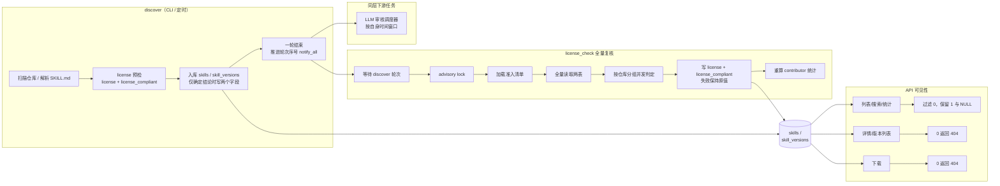
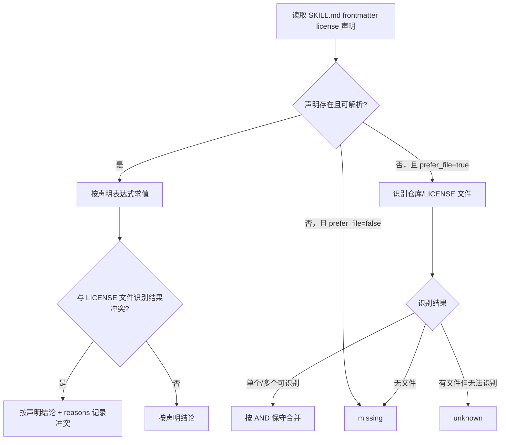
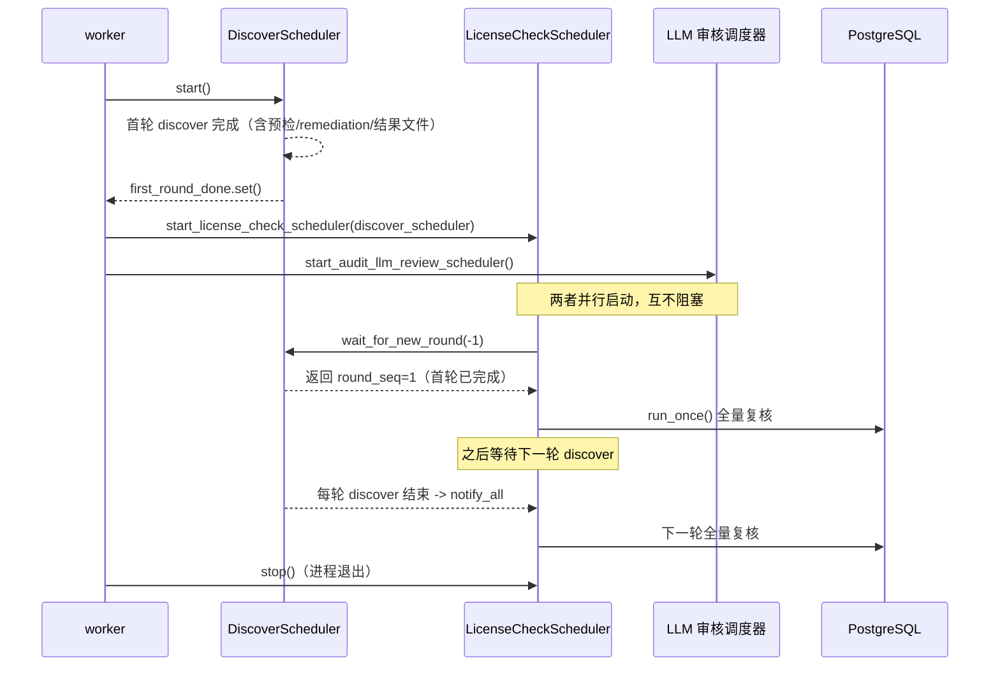
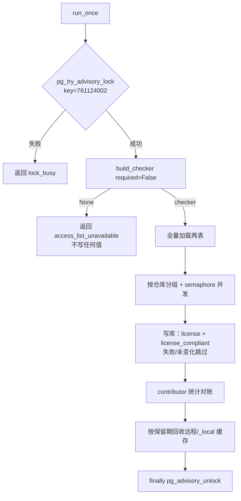

# Skill License 类型与合规标记设计

## 一、背景

平台需要对外分发第三方仓库中的 Skill，必须保证下发的 Skill 满足 openEuler
社区的 license 准入要求。早期方案在入库阶段直接删除 license 不合规的 Skill，
存在两个问题：

1. **不可追溯**：删除后无法统计、无法向作者反馈、无法复检；
2. **判定成本耦合入库**：discover 每轮都要读取仓库 license 文件，放大了
   扫描耗时，且准入清单更新后存量数据不会重新判定。

新方案改为**只标记、不删除**，并在 `skills` / `skill_versions` 上维护两个
字段：

- `license`：本次判定得到的**具体 license 类型**（归一化 SPDX 表达式）；
- `license_compliant`：三态合规结论（`1` / `0` / `NULL`）。

写入分两条互补链路：

- discover 在扫描新入库/内容变化的 skill 时做一次**内联预检**，使新数据
  立即可用；
- license 全量复核任务在**每轮 discover 结束后**兜底，补齐历史存量、跟随
  准入清单更新结论并回收缓存。

### 设计目标

| 目标 | 说明 |
|------|------|
| 不删除 | 不合规数据保留在库中，仅从对外可见集合中过滤 |
| 可区分 | 「未检查」与「检查后不合规」必须是两种状态，不能混为一谈 |
| 类型可见 | 除三态结论外，还要记录具体的 license 类型（SPDX 表达式） |
| 口径一致 | discover 预检与全量复核共用同一套判定引擎，结论必须一致 |
| 声明优先 | 以 SKILL.md 的 `license` 声明为准，LICENSE 文件仅作回退 |
| 失败不误判 | 基础设施错误（清单不可用、仓库不可读）不得写成「不合规」 |

---

## 二、总体架构



关键边界：

- discover **会 import** license 判定模块：每轮惰性构建一个 `LicenseChecker`，
  对本次构建的 record 做预检，只写 `license` / `license_compliant`；不跳过、
  不删除任何 skill。
- license 全量复核任务**不新增/不删除**任何 skill，只更新两个字段值并重算
  贡献者统计；它排在每轮 discover 之后执行，避免与扫描并发读写本地 clone。
- 两条链路共用 `gate_engine` / `verdict_to_flag` / `verdict_to_license`，
  判定口径一致。
- API 层只读取字段做可见性判断，不做判定。

---

## 三、数据模型

### 3.1 字段定义

`skills` 与 `skill_versions` 各新增两个字段，分别由
`015_add_license_compliant.py` 与 `016_add_skill_license.py` 引入：

```sql
-- 015：三态合规结论
ALTER TABLE skills          ADD COLUMN IF NOT EXISTS license_compliant SMALLINT NULL;
ALTER TABLE skill_versions  ADD COLUMN IF NOT EXISTS license_compliant SMALLINT NULL;
ALTER TABLE skills          ADD CONSTRAINT ck_skills_license_compliant
    CHECK (license_compliant IN (0, 1));
ALTER TABLE skill_versions  ADD CONSTRAINT ck_skill_versions_license_compliant
    CHECK (license_compliant IN (0, 1));

-- 016：具体 license 类型（归一化 SPDX 表达式）
ALTER TABLE skills          ADD COLUMN IF NOT EXISTS license TEXT NULL;
ALTER TABLE skill_versions  ADD COLUMN IF NOT EXISTS license TEXT NULL;
```

### 3.2 `license` 语义

`license` 保存判定引擎 `LicenseVerdict.expression` 归一化后的结果：

| 判定输入 | `license` 取值 |
|---|---|
| 声明可解析（`MIT`、`MIT AND Apache-2.0`） | 声明表达式本身 |
| 无声明、由 LICENSE 文件识别 | 识别结果（多个文件按 AND 拼接） |
| `missing`（无声明且无文件） | `NULL` |
| `unknown` 但声明非空 | 保留原始声明，便于回溯“为什么判成不合规” |
| `error`（仓库不可读等） | `NULL`，且本轮**不写库** |

`license` 与 `license_compliant` 必须来自**同一次判定**：`runtime.py` 中
`verdict_to_license(verdict)` 与 `verdict_to_flag(verdict.status)` 共用同一个
`LicenseVerdict`，避免出现“类型是 A、结论按 B 算”的错配。

### 3.3 三态语义

| 取值 | 含义 | 产生条件 | 对外可见 |
|------|------|----------|----------|
| `1` | 已检查且合规 | 判定状态 `allowed` | 是 |
| `0` | 已检查但不合规 | `restricted` / `black` / `missing` / `unknown` | 否 |
| `NULL` | 尚未得到确定结论 | 新入库未跑任务；或历史判定始终失败、从未写入过 1/0 | 是（未检查 ≠ 不合规） |

> 判定失败**不是**一种独立状态：本轮失败的已有记录保留数据库原值
> （`license` 与 `license_compliant` 都保留），不会统一改成 `NULL`。
> 详见 4.2 与 6.5。

### 3.4 设计取舍

**为什么 `license_compliant` 用 `SMALLINT NULL` 而不是 `BOOLEAN`**

`BOOLEAN` 只有两态，无法表达「未检查」。若用 `BOOLEAN NOT NULL DEFAULT false`，
则所有新入库数据在任务跑之前都会被误判为不合规并从列表消失。

**为什么 `license` 用 `TEXT` 而不是 `VARCHAR(n)`**

声明可能是列表或复合表达式（如 `MIT AND Apache-2.0`），长度不可预估；
`TEXT` 避免截断或写入失败，也不需要为不同仓库调整长度上限。

**为什么 `CHECK (col IN (0,1))` 允许 NULL**

SQL 的 CHECK 约束对 NULL 求值为 UNKNOWN，视为通过。因此该约束只拦截
`2`、`-1` 等非法值，同时允许三态中的 NULL，正好符合需求。

**为什么两张表都加**

- `skills`：控制详情、下载、列表/搜索/统计；
- `skill_versions`：版本列表需要独立展示每个版本的 license 与合规结论，
  下载指定版本时也按版本行判断。

**为什么没有索引**

可见性过滤条件为 `(license_compliant IS NULL OR license_compliant = 1)`，
选择性低（绝大多数行为 1），单列索引收益有限；列表查询已有其他过滤与
排序条件，是否加索引应结合实际执行计划再评估。`license` 只用于展示与排查，
不参与过滤，无需索引。

### 3.5 迁移与回滚

- 015：`015_add_license_compliant`，`down_revision = 014_add_skill_embedding_hnsw`；
- 016：`016_add_skill_license`，`down_revision = 015_add_license_compliant`；
- 两个迁移都使用 `IF NOT EXISTS` / `IF EXISTS`，重复执行安全；
- downgrade 先删约束/列，016 只删 `license` 列；
- 迁移**不回填**：存量数据保持 NULL，由 discover 预检与任务首轮全量复核
  写入。这样迁移本身不依赖网络与仓库文件树，可在任意环境安全执行。

---

## 四、判定规则

判定引擎位于 `src/skills/license/`，从 openeuler-jenkins 门禁 vendored
而来（`gate_engine.py`），保证与社区准入口径一致；`scanner.py` 负责准备
仓库文件树，`runtime.py` 负责把同一个 `LicenseVerdict` 映射为
`license`（表达式）与 `license_compliant`（三态）两个字段。

### 4.1 判定优先级



**声明优先**的具体含义：

- SKILL.md 的 `license` 字段是可解析的 license 表达式（如 `MIT`、
  `Apache-2.0 OR MIT`）时，**只**按声明判定；
- LICENSE 文件内容不同**不会推翻**声明结论，只会在 `reasons` 中追加
  `declared=... but LICENSE file looks like ...`，用于人工复核；
- 声明是描述性占位（如 `Complete terms in LICENSE.txt`）、声明缺失或无法
  解析，且存在可识别的 LICENSE 文件时，才回退到文件；
- 单 token 但清单未收录的写法（如 `SSPL`）**不回退**到文件，避免受限/
  黑名单许可被 LICENSE 文件静默放行；
- 声明为 `restricted` 但文件为 `permissive` 时，结论仍是 `0`——不再有
  「文件 rescue」分支。

### 4.2 状态到字段的映射

`src/skills/license/runtime.py::verdict_to_flag`：

| 判定状态 | 含义 | `license_compliant` |
|----------|------|---------------------|
| `allowed` | 准入清单可分发（含 `extra_allow` 命中） | `1` |
| `restricted` | openEuler 受限使用，需合规 SIG 评审 | `0` |
| `black` | 禁止使用 | `0` |
| `missing` | 既无声明也无 LICENSE 文件 | `0` |
| `unknown` | 清单未收录 / 无法识别 / 表达式非法 | `0` |
| `error` | 仓库不可读、git 超时、路径越界、扫描异常等 | `None`（不写库） |
| `conflict` | 历史常量，已不再作为终态返回 | — |

`license` 由同一文件中的 `verdict_to_license(verdict)` 提取，规则见 3.2；
`error` 同样返回 `None`，调用方跳过两列，不覆盖数据库原值。

discover 预检与全量复核都调用这两个函数，因此同一 `LicenseVerdict` 在两条
链路得到的 `(license, license_compliant)` 必然一致（实测 9,265 个备份 skill
两条链路 0 差异，见 9.4）。

`error -> None` 是安全底线：`None` 表示“本轮没有结论”，不是要写入
`NULL`。`_persist` 遇到 `None` 会跳过该行，因此：

| 原值 | 本轮判定失败后 | 对外表现 |
|------|----------------|----------|
| `1` | 保持 `1` | 继续可见 |
| `0` | 保持 `0` | 继续隐藏 |
| `NULL` | 保持 `NULL` | 继续可见 |

失败有三种来源：

1. 单条判定返回 `error`（仓库不可读、git 超时、`skill_dir` 越界、扫描异常）；
2. `_check_rows` 捕获到未预期异常，把该条 flag 记为 `None`；
3. 准入清单不可用：整轮直接返回 `access_list_unavailable`，不加载、不写库。

失败只计入本轮 `errors` 统计并打日志，下一轮会重试；不会把已有的 `1`/`0`
改成 `NULL`，也不会因为临时故障把 skill 下线或放行。代价是仓库永久失效
时旧结论会长期冻结（旧 `1` 继续可见、旧 `0` 继续隐藏），当前没有“连续
失败 N 次后降级”的机制。

### 4.3 `conflict` 说明

旧门禁把「声明与文件不一致」作为 `conflict` 终态（warning 放行），需要
人工介入。新方案明确以 SKILL.md 声明为准，因此：

- `STATUS_CONFLICT` 常量保留（兼容上游代码与日志检索），但 `scan()` 不再
  返回该状态；
- 冲突信息追加到 `LicenseVerdict.reasons`，随日志输出；
- 结论按声明计算（`allowed` 即写 1，`restricted` 即写 0）。

### 4.4 仓库文件树来源

`LicenseChecker._resolve_repo_root` 按优先级准备文件树：

| 优先级 | 来源 | 判定结果 `repo_source` |
|--------|------|------------------------|
| 1a | `skill_repos.local_path` 的本地 clone **且有工作树** | `local` |
| 1b | 本地 clone 无工作树（discover 的 `--no-checkout`），从本地 git 对象库按 HEAD 物化 license 文件 | `local_tree` |
| 2 | `<remote_cache_root>/<host_owner_repo>` 未过期缓存 | `remote_cache` |
| 3a | 轻量拉取：`clone --filter=blob:none --no-checkout` 后只物化 license 文件 | `remote_fetch` |
| 3b | 完整浅克隆 `clone --depth 1` | `remote_fetch` |
| — | 全部失败 | `error`（该行不写库） |

**为什么需要 1b**：discover 的本地 clone 使用
`git clone --depth 1 --no-checkout --filter=blob:none`，目录里只有
`.git`，没有 `LICENSE` 等工作树文件。若直接按工作树扫描，会把所有没有
可解析 `license` 声明的 skill 误判为 `missing` 并写成 0。1b 只执行
`git ls-tree` + 少量 `git show`（blob 缺失时由 Git 懒拉取），把 license
文件物化到缓存目录，不触发完整 checkout；物化失败则回退到 2/3。
物化结果按仓库路径的 16 位 sha1 前缀缓存在
`<remote_cache_root>/_local/<hash>/`，marker 记录 HEAD：HEAD 未变时下一轮
直接复用，避免每天重复懒拉取；HEAD 变化时整体重建该仓库目录。没有配置
远程缓存根时退化为本轮临时目录。

物化还有三个边界：

- 单仓库最多读取 80 个 license 文件（`paths[:80]`），每个文件一次
  `git show`；license 文件很多的仓库（如 next.js）首轮可能耗时数十秒；
- 只要计划读取的 license 文件（最多 80 个）没有全部取到（blob 懒拉取
  失败），就丢弃本次物化结果并回退远程缓存/拉取，避免把不完整文件树当成
  `missing`；
- `skill_dir` 必须落在仓库根内：`resolve()` 后做 `relative_to` 校验，
  `..`、绝对路径或指向仓库外的符号链接一律按 `error` 处理，不读取仓库外
  的 LICENSE。

所有 git 命令带 `GIT_TERMINAL_PROMPT=0` 与 `git_timeout`，避免任务被
交互式认证或网络挂起。临时目录由 `LicenseChecker.close()` 在本轮结束时
清理；`_local` 与远程缓存目录保留供后续轮次复用。

远程缓存只有在存在 `.license_fetched_at` marker 时才视为新鲜：拉取中断
留下的无 marker 半成品目录不会被复用，下次拉取会先清空重建（见 6.6）。

### 4.5 目录级 LICENSE 缓存

`LicenseScanner._license_files_in` 以 `(repo_root, directory)` 为键缓存
目录下的 license 文件列表（含空结果），生命周期与 checker 实例一致
（即一轮任务）。

解决的问题：同一仓库可能有几十到几千个 skill，每个 skill 都会向上遍历
父目录查找 LICENSE；无缓存时同一父目录会被反复 `iterdir()`。缓存后每个
目录只盘点一次。

实测（本地 SSD，单仓库 N 个同级 skill 目录）：

| 同仓库 skill 数 | 无缓存单次耗时 | 有缓存单次耗时 |
|-----------------|----------------|----------------|
| 100 | 0.86 ms | 0.28 ms |
| 500 | 3.26 ms | 0.26 ms |
| 2000 | 13.40 ms | 0.26 ms |

2000 次判定的纯判定耗时从约 27 s 降至约 0.5 s。

---

## 五、可见性规则

统一原则：**只有 `0` 被隐藏，`NULL` 与 `1` 可见。**

### 5.1 过滤表达式

列表/搜索/统计等「集合查询」使用：

```python
or_(Skill.license_compliant.is_(None), Skill.license_compliant == 1)
```

不能写成 `license_compliant != 0`：SQL 三值逻辑下 `NULL != 0` 结果是
UNKNOWN，会把「未检查」一并排除，违背「NULL 可见」的约定。

### 5.2 各入口行为

| 入口 | 实现位置 | 规则 |
|------|----------|------|
| Skill 列表 | `SkillRepository._apply_skill_filters` | 过滤 0 |
| 关键词搜索 | `indexer/search.py::_text_search` | 复用 `_apply_skill_filters`，过滤 0 |
| 语义搜索（ORM） | `indexer/search.py::_apply_skill_filters` | 过滤 0 |
| 语义搜索（原生 SQL） | `indexer/search.py` 的 `where_clauses` | `IS NULL OR = 1`，需与 ORM 保持同步 |
| 平台统计 | `_latest_unique_skills_subquery` | 过滤 0，保证统计口径与列表一致 |
| 贡献者 Skill 列表/计数 | `get_contributor_skills` / `count_skills` | 过滤 0 |
| 贡献者统计对账 | `reconcile_skill_counts` | 与列表同口径 |
| Skill 详情 `GET /skills/{id}` | `api/routes/skills.py::get_skill` | `== 0` 返回 404 |
| 审计信息 `GET /skills/{id}/audit` | `api/routes/skills.py::audit_skill` | `== 0` 返回 404 |
| 审计报告 `GET /skills/{id}/audit-report` | `api/routes/skills.py::get_skill_audit_report` | `== 0` 返回 404 |
| 版本列表 | `get_versions_by_base_skill` | 过滤 0 |
| 下载（latest / 指定版本） | `download_skill` | 对应行 `== 0` 返回 404，且在打包与写下载记录之前判断 |

**为什么详情/下载/审计用 404 而不是 403**：不合规资源不应暴露存在性，404
与「资源不存在」一致，避免被用于探测。

管理员 `POST /skills/{id}/audit` **不做** `0` 过滤，保留对不合规记录触发/
重跑安全审计的排障能力；它不返回 skill 详情。

**版本列表与详情的关系**：详情返回的是 `skills` 行的最新版本摘要，按
skill 级结论判断；版本列表与指定版本下载都按对应 `skill_versions` 行
判断，因此 latest 不合规不会连带隐藏/拦截合规的历史版本。为避免探测，
当 latest 为 0 且没有任何可见历史版本时，版本列表返回 404。

### 5.3 API 返回字段

`SkillResponse` 直接透出两个字段：

- `license: str | None`：具体 license 类型（SPDX 表达式）；
- `license_compliant: int | None`：三态值。

前端可据此展示「license 类型 + 未检查 / 合规 / 不合规」标识，无需额外接口。
列表、搜索（ORM 与原生 SQL）、版本列表、贡献者技能列表都返回这两个字段。

---

## 六、license 全量复核任务

实现文件：`src/jobs/license_check.py`，由 `src/jobs/worker.py` 启动。

### 6.1 调度生命周期



- worker 先等 discover 首轮完成，再**并行**启动 license 与 LLM 审核；
- license 之后跟随每一轮 discover：`DiscoverScheduler` 用轮次序号 +
  `asyncio.Condition` 通知，license 消费序号后执行一轮全量复核；
- 每轮触发点在 `run_discover_once` 返回之后：此时扫描、remediation、结果
  文件都已结束，本地 clone 不再被更新；
- `discover_scheduler.enabled=false` 时退化为旧的「启动立即一轮 + 每天
  `license_check.start_time` 触发」；
- 单轮异常只记录日志，不退出循环；`first_round_done` 在 finally 中置位，
  避免等待方永久阻塞；
- 无固定结束时间窗口，跑完为止。

### 6.2 并发控制与幂等



- **advisory lock**：会话级锁，多副本部署时同一时刻只有一个实例执行；
  使用独立的 `lock_session`，因为会话锁必须由持锁连接释放；
- **幂等**：全量复核、只写变化行，重复执行结果一致；
- **清单不可用**：整轮跳过，不把全库写成 0，也不回收缓存；
- **缓存回收**：在写库/统计对账之后执行，失败只记日志，不回滚本轮 license
  结论。

### 6.3 全量加载

`_load_records` 一次读取两表全部行（JOIN `skill_repos` 取 `url` /
`local_path`），每行包含：

| 字段 | 用途 |
|------|------|
| `id` / `table` | 回写目标 |
| `skill_id` | 日志定位 |
| `source_url` | 经 `derive_skill_dir` 推导 skill 相对目录 |
| `extra_metadata` | 读取 `license` 声明 |
| `license` / `license_compliant` | 当前值，用于跳过未变化行 |
| `url` / `local_path` | 仓库分组与文件树定位 |

**不过滤 NULL**：每轮全量复核（生产为每日一轮）必须能修正已有结论（例如
准入清单新增黑名单后，存量 `1` 需要变 `0`）。只补 NULL 会漏掉这类回归。

### 6.4 分组、并发与缓存

`_check_rows` 采用三级策略：

1. **仓库级并发**：key 为 `(repo_url, local_path)`，不同仓库通过
   `asyncio.Semaphore(repo.remote_concurrency)` 限流；同仓库内串行，避免
   并发 clone 冲突，并复用目录缓存；
2. **技能级结论复用**：仓库内以 `(skill_dir, normalize_expression(declared))`
   为键缓存 `(flag, license)`。声明可能是 YAML list（如
   `license: [MIT, Apache-2.0]`），不能直接作 dict key，先归一化成字符串。
   同一 skill 的多个 tag 版本共享目录与声明，只判定一次；同一目录下多个
   声明相同的 skill 也复用；
3. **目录级文件缓存**：见 4.5。

判定失败（`None`）也会写入该缓存：同一 key 的其他版本直接复用，不会重复
拉取。但不同 skill 目录/声明仍会各自触发仓库准备，因此一个不可用仓库可能
被重试多次（见第十二节风险表）。

discover 侧的预检使用同样的 `(skill_dir, 声明)` 缓存，但**不缓存失败**
（失败返回 `(None, None, False)` 且不写缓存），让其他版本或下一轮可以重试；
缓存随每次 `start_scan`（每仓库）重置。

`checker.check` 是阻塞调用（文件系统 / git），统一通过
`asyncio.to_thread` 执行；线程间只共享只读准入清单与 dict 缓存，最坏
情况是重复计算一次，不产生正确性问题。

### 6.5 写库策略

`_persist`：

- `flag is None`：计入 `errors`，**不写库**；数据库原值（`license` 与
  `license_compliant`，可能是 `1`/`0`/`NULL`）原样保留，不会写成 `NULL`
  或 `0`；
- `(flag, license)` 与当前值都相同：跳过，减少全量复核的 WAL 与行锁开销；
  只要 license 类型变化（例如声明修正）就更新；
- 其他按 `(table, flag, license)` 聚合，`UPDATE ... WHERE id IN (...)`
  同时写两列，分批提交，批大小 `license_check.batch_size`（默认 200）；
  每批独立 commit，某批失败会中断后续批次，但已提交批次保留，不会整体回滚；
  license 类型通常只有几十种取值，聚合后语句数量可控；
- 写完后调用 `ContributorRepository.reconcile_skill_counts(commit=False)`
  做一次全量对账：`1 -> 0` 会让 skill 从列表消失，贡献者 `skill_count`
  必须同步下调；反向变化同理。对账失败只回滚统计更新，不影响已写入的
  license 结论。

### 6.6 缓存回收

每轮 `_persist` 之后调用 `_prune_caches`，按
`repo.remote_cache_keep_days`（默认 7 天）回收两类缓存：

- **远程仓库缓存**：`prune_remote_cache(keep_days, active_keys)`；本轮仍在
  扫描的 `normalize_repo_key` 集合作为 active 集合，active 目录无论 mtime
  多旧都保留；其余目录只有「含 `.license_fetched_at` marker」且 marker
  mtime 超过保留期才删除，无 marker 的目录视为其他数据，一律跳过；
- **`_local` 物化缓存**：`prune_local_cache(keep_days)`；用 checker 本轮
  实际物化过的目录（`_local_trees`）作为 active 集合，只删除仓库移除、
  `local_path` 变化后遗留且超过保留期的目录；同样只处理「目录名为 16 位
  sha1 前缀 + 含 marker」的本模块目录，防止 `remote_cache_root` 误配到
  共享目录时误删无关数据。

远程 active 集合来自本轮数据库中的全部仓库 URL：即使某个仓库实际使用了
本地 clone、没有命中远程缓存，也会保留其远程缓存。这是偏保守的选择，避免
误删仍在扫描范围内的仓库缓存。

数据库为空时 active 集合为空，超过保留期的远程/`_local` 缓存会被回收；
缓存只是可重建的派生数据，不影响 `skills` / `skill_versions`。如果担心
空库是误连导致，可在任务层改为“无记录时跳过回收”。

两类回收都跳过软链接，避免跟随链接删除目标目录。`_local` 中物化中断
（无 marker）的残留不会被回收，但下次物化会检测到 HEAD 不匹配并整体重建。

远程缓存的 marker 内容是拉取时间戳，`_local` 的 marker 内容是 HEAD；
回收判断统一使用 marker 的 mtime，`_local` 的 marker 内容仅用于复用判断。

缓存复用（`_cache_fresh`）与回收使用同一套 marker 语义：没有
`.license_fetched_at` 的远程目录不视为新鲜，避免把拉取中断的半成品当成
完整文件树扫描（会把仓库误判为 `missing`）；下次拉取时会先清空再重建。

`remote_cache_keep_days <= 0` 时跳过清理；清理失败只记日志，不影响本轮
license 结论与写库结果。

### 6.7 本轮统计

`run_once` 返回并打印：

| 字段 | 含义 |
|------|------|
| `scanned` | 本轮读取行数（两表之和） |
| `checked` | 得到确定结论（1/0）的行数 |
| `compliant` / `non_compliant` | 结论为 1 / 0 的行数 |
| `errors` | 判定失败、保持原值的行数 |
| `duration_seconds` | 本轮耗时 |

提前终止时返回 `{"stopped": "lock_busy"}` 或
`{"stopped": "access_list_unavailable"}`。

---

## 七、配置

```yaml
license_check:
  enabled: true
  # 仅在 discover_scheduler.enabled=false 时生效；
  # discover 开启时改为“每轮 discover 结束后”触发
  start_time: "02:00"
  timezone: "Asia/Shanghai"    # 与容器 TZ 解耦
  batch_size: 200              # 每批 UPDATE 行数
  gate:
    access_list_url: "https://api.atomgit.com/api/v5/repos/openeuler/compliance/raw/doc/rule/Licenses_Access_List.yaml?ref=master"
    access_list_cache: ""      # 空则 <storage.local_path>/license/Licenses_Access_List.yaml
    access_list_ttl_hours: 24
    access_list_timeout: 30
    extra_allow: [CANN-2.0, SUL-1.0, FSL-1.1-Apache-2.0, Convex-CPL, CC-BY-3.0-US]
    prefer_file: true          # 仅声明无法解析时回退 LICENSE 文件
  repo:
    remote_cache_root: ""      # 空则 <storage.local_path>/license-repos
    remote_cache_ttl_days: 7
    remote_cache_keep_days: 7  # 回收本轮未使用且超过 N 天的缓存；0 禁用
    remote_fetch: true         # 本地 clone 缺失时是否允许远端拉取
    remote_concurrency: 4      # 同时判定多少个仓库
    git_timeout: 60            # 单条 git 命令超时（秒）
```

对应配置模型：`src/core/config.py` 的 `LicenseCheckConfig` /
`LicenseGateConfig` / `LicenseRepoConfig`。

`remote_cache_ttl_days` 与 `remote_cache_keep_days` 含义不同，互不影响：

- `remote_cache_ttl_days`：复用新鲜度，超过后重新拉取；
- `remote_cache_keep_days`：回收保留期，本轮未使用且超过该天数才删除。

两者默认都是 7 天。若 `keep_days < ttl_days`，非 active 缓存会在“仍可复用”
之前被回收；active 缓存不受影响。

环境变量覆盖目前只支持**一级字段**（`_apply_env_overrides` 只按第一个
`__` 拆分），例如 `LICENSE_CHECK__ENABLED=false`、
`LICENSE_CHECK__START_TIME=02:00`。`gate.*` / `repo.*` 等嵌套字段请直接
写在 `config.yaml` 中；`LICENSE_CHECK__GATE__PREFER_FILE` 这类三段式
环境变量不会生效（会被忽略）。

---

## 八、与 discover 的分工

| 事项 | discover | license_check |
|------|----------|---------------|
| 解析 SKILL.md | 是（入库必需） | 否（读已存 `extra_metadata.license`） |
| 读取 LICENSE 文件 | 是（预检，仅本次构建的 record） | 是（全量） |
| 加载准入清单 | 是（每轮惰性构建 checker） | 是（每轮） |
| 写 `license` / `license_compliant` | 是（仅确定结论时） | 是（仅变化行） |
| 覆盖范围 | 本轮扫描到的新入库/内容变化 record | 全库两表 |
| 删除 skill | 否 | 否 |
| 触发时机 | 扫描仓库时 | 每轮 discover 结束后 |

discover 侧写入规则：

- 新增记录：直接带上本次预检的 `license` / `license_compliant` 插入；
- 内容变化更新：只有本轮确实得到确定结论（record 带 `_license_checked=True`）
  才在 UPDATE 中带上这两列；预检失败/checker 不可用时保留数据库原值；
- 两个字段成对写入，避免“新类型 + 旧结论”的错配；
- 不满足 license 要求**不会跳过或删除** skill，只影响 API 可见性。

并发与覆盖关系：

- license 全量复核排在每轮 discover 之后（轮次序号 + `asyncio.Condition`），
  不与扫描并发读写本地 clone；因此 discover 可以安全地在更新时写这两个字段，
  不再需要旧的“UPDATE 完全不触碰 license 列”约束；
- discover 的“仅确定结论时写”仍然保留，防止临时基础设施故障把任务刚写入的
  结论清空；
- 两条链路在同一行上不会同时写入：discover 写本轮扫描到的 record，任务写
  全库变化行，且时间上串行。

---

## 九、性能评估

### 9.1 单轮耗时构成

| 阶段 | 说明 | 量级 |
|------|------|------|
| discover 预检 | 每个新构建 record 一次判定；目录缓存 + 技能级缓存生效后 | 9,265 个 skill 约 3.7 s（本地 worktree 实测） |
| 全量读库 | 两表 JOIN 一次性读取 | 万级行 < 1 s |
| 文件树准备 | 有工作树时几乎为零；`--no-checkout` clone 首轮 `ls-tree` + `git show`（可能懒拉取），HEAD 不变时后续轮次复用 `_local` 缓存 | 每仓库首轮几十 ms 至数十秒；license 文件多的仓库（最多 80 个 blob，逐个 `git show`）可达约 80 s |
| 判定 | 目录缓存生效后每 skill 约 0.3-1 ms（取决于 license 文件数量与目录深度） | 50k skill 约 15-50 s |
| 写库 | 仅变化行，分批 200；每批独立 commit | 取决于变更量，本地库万级首写约数秒 |
| 贡献者对账 | 全量聚合 | 通常 < 1 s |

### 9.2 典型估计

| 唯一 skill 目录数 | 有工作树 / 已物化缓存的纯判定 | 含远端拉取的估算 |
|-------------------|-------------------------------|------------------|
| 2 000 | 1-2 s | 1-5 min |
| 10 000 | 3-10 s | 5-20 min |
| 50 000 | 15-50 s | 30-90 min |

主要风险不是判定本身，而是**本地 clone 缺失或 license blob 懒拉取失败**
导致按仓库远端拉取（单仓库 1-10 s，最坏 `git_timeout` 60 s），以及首次
部署时所有 `--no-checkout` clone 都要物化一遍 license 文件。可通过以下
方式控制：

- 保证 discover 维护的本地 clone 覆盖主要仓库；
- `_local` 缓存按 HEAD 复用，日常轮次通常只做 `rev-parse`；
- 调大 `remote_cache_ttl_days` 提高远程缓存复用；
- 关闭 `remote_fetch`（只使用本地 clone 与已有缓存，缺失即 error 不写库）；
- 调大 `repo.remote_concurrency`（受网络与磁盘限制）。

### 9.3 测试环境备份实测（2026-11，远程缓存场景）

> 本节是加入 discover 预检之前、按“每日 02:00 全量复核”配置做的远程缓存
> 场景实测，保留用于评估无本地 clone 时的上限；本地 worktree + 最新代码的
> 实测见 9.4。

数据规模：9,265 个 skills + 6,278 个 `skill_versions`（15,543 行），506 个
仓库，9,265 个唯一 skill 目录。版本行与 skill 共享目录，不增加判定次数；
其中版本行按测试环境 manifest 的 6,278 条构造，只影响 DB 读写量。

| 场景 | 实测/估算 | 说明 |
|------|-----------|------|
| 首次全量：无本地 clone、远程冷缓存 | **707 s ≈ 11 min 47 s** | 506 个仓库远程拉取，实测跑完 |
| 远程缓存热（含 2 个失效仓库） | **195 s** | 大部分耗在失效仓库逐 skill 重试 |
| 远程缓存热，排除失效仓库 | **10.15 s** | load 0.25 + check 9.55 + persist 0.34 + prune 0.01 |
| 本地 clone + `_local` 冷缓存 | 约 9-10 min（样本外推） | 20 仓库样本线性外推；license 文件多的仓库是热点 |
| 本地 clone + `_local` 热缓存（每日稳态） | 约 10-20 s | 9,265 次判定约 6-10 s，加 DB 开销 |

测试机为 macOS、`remote_concurrency=4`、`git_timeout=60`，不同网络/磁盘
会有偏差。测试数据中 2 个仓库已远程 404（38 个 skill），每轮会按 skill
目录重复尝试远程拉取，额外约 76 s；详见第十二节风险表。

### 9.4 本地集成实测（2026-11，最新代码）

用测试环境备份数据构造 506 个伪仓库 / 9,265 个 skill / 9,265 个版本行
（共 18,530 行），本地 PostgreSQL 16 实测：

| 场景 | 实测 |
|------|------|
| 全量复核首轮 | **7.3 s**（compliant 14,786；non_compliant 3,744；errors 1 为故意构造的不可读仓库） |
| 全量复核第二轮 | 6.2 s；`skills` 表 `n_tup_upd=0`、`n_tup_ins=0`，结论幂等 |
| discover 预检 9,265 个 skill | **3.7 s**，与全量复核结果 **0 差异** |
| 不可读仓库 | `errors=1`，原值 `license='MIT'` / `license_compliant=1` 保持不变 |
| `--no-checkout` 物化（300 skill、5 个 license 文件） | 首轮 0.28 s，次轮复用 `_local` 缓存 0.21 s |

这组数据验证了字段写入、两表一致性、幂等、失败保留原值与 discover 预检
口径一致；生产首次运行如果触发 partial clone 的 blob 懒拉取，耗时会受网络
影响，后续轮次复用 `_local` 缓存。

---

## 十、运维

### 10.1 首次上线 / 回填

1. 执行迁移（Alembic 自动或手动 `alembic upgrade head`，需包含 015 与 016）；
2. 确认 `license_check.enabled=true` 且准入清单地址可访问；
3. 启动 worker：discover 首轮完成后 license 调度器立即跑一轮全量；discover
   扫描到的新数据已经带有预检结果；
4. 通过日志 `[LicenseCheck] round finished: scanned=... compliant=...
   non_compliant=... errors=...` 确认结果；
5. 抽查 `license` / `license_compliant` 两列均已回填（存量 NULL 会在首轮补齐）。

### 10.2 常用核查 SQL

```sql
-- 三态 + license 类型分布
SELECT license, license_compliant, count(*)
FROM skills GROUP BY 1, 2 ORDER BY 3 DESC;
SELECT license, license_compliant, count(*)
FROM skill_versions GROUP BY 1, 2 ORDER BY 3 DESC;

-- 仍未检查的记录（任务未覆盖或持续失败）
SELECT id, skill_id, source_url FROM skills WHERE license_compliant IS NULL LIMIT 50;

-- 异常：合规但无 license 类型（正常只可能出现在历史手工数据）
SELECT id, skill_id FROM skills
WHERE license_compliant = 1 AND license IS NULL LIMIT 50;

-- 版本与主表结论不一致（排查数据口径；不同 tag 声明可能不同，不等于 bug）
SELECT s.skill_id, s.license, s.license_compliant AS skill_flag,
       v.version, v.license, v.license_compliant AS version_flag
FROM skills s JOIN skill_versions v ON v.skill_id = s.skill_id
WHERE (s.license, s.license_compliant) IS DISTINCT FROM (v.license, v.license_compliant)
LIMIT 50;
```

> 注：版本与主表结论本来就可能不同（不同 tag 的 license 声明可能变化），
> 上一条 SQL 只用于排查异常，不代表必然有 bug。

### 10.3 手工触发一轮

可在运维容器内调用 worker 之外的任务入口（或临时脚本）：

```python
import asyncio
from src.core.config import get_settings
from src.jobs.license_check import LicenseCheckScheduler

async def main():
    sched = LicenseCheckScheduler(get_settings().license_check)
    print(await sched.run_once())

asyncio.run(main())
```

`run_once` 自带 advisory lock，可与线上调度器并存（后者会返回
`lock_busy`）。

### 10.4 常见问题

| 现象 | 可能原因 | 处理 |
|------|----------|------|
| 大量 `errors`，日志含「仓库文件树不可用」 | 本地 clone 缺失且远端拉取失败 | 检查仓库可访问性、token、`git_timeout` |
| 整轮 `access_list_unavailable` | 准入清单 URL 不可达且无可用缓存 | 检查网络，或预置 `access_list_cache` |
| 全部记录变 0 | 声明表达式非法 / 清单格式变化 | 查看 `reasons`，确认清单版本 |
| 任务一直 `lock_busy` | 上一轮未结束或另一副本在跑 | 查 `pg_locks`，确认是否有长事务 |
| 列表数与预期不符 | NULL 未检查记录仍可见 | 用 10.2 的分布 SQL 确认 |
| 新入库 skill 的 `license` 为空 | discover 预检时准入清单不可用 / checker 初始化失败 | 查 discover 日志 `license pre-check`；下一轮 license 任务会兜底 |
| `license` 与 `license_compliant` 不一致 | 两列必须成对写入；出现不一致通常是手工改库或旧数据 | 用 10.2 的异常 SQL 排查，重新跑一轮任务修正 |
| `errors` 非 0，但旧记录仍可见/隐藏 | 失败行保留原值，不会自动改成 NULL/0 | 查日志与仓库可访问性；确认旧结论是否符合预期，必要时人工修正 |
| 单轮耗时远超预期 | 失效/超时仓库被多个 skill 目录反复重试 | 查 `errors` 与「仓库文件树不可用」日志；优先补本地 clone，后续加按轮次的失败仓库短路 |

---

## 十一、测试

`tests/test_license_check.py`（31 个用例）覆盖：

| 类别 | 用例 |
|------|------|
| 状态映射 | allowed→1；restricted/missing/unknown/black→0；error→None |
| 类型映射 | `verdict_to_license`：声明/文件表达式原样返回；missing/error→None；unknown 保留声明 |
| 声明优先 | 声明 MIT + LICENSE Apache → allowed；声明 MIT + GPL 文件 → allowed 且 reasons 记录冲突 |
| 声明受限 | 声明 GPL + MIT 文件 → restricted（0），文件不能 rescue |
| 缺失/未知 | 无声明无文件 → missing；有文件无法识别 → unknown |
| 目录缓存 | 同一父目录只 listing 一次 |
| 任务判定 | 按仓库分组；`(skill_dir, normalize_expression(declared))` 复用 `(flag, license)`；列表声明可哈希；异常 → None |
| 任务写库 | license 与 license_compliant 成对写入；仅 license 变化也更新；未检查行跳过 |
| discover 预检 | 返回 `(license, flag, checked)`；按 `(skill_dir, 声明)` 复用；异常不缓存、返回全 None |
| 调度触发 | license 在 discover 轮次结束前不执行，每轮结束后执行一次 |
| 路径边界 | `..` / 绝对路径越出仓库根 → error（不读仓库外 LICENSE） |
| 无工作树 clone | `--no-checkout` clone 从 git 对象库物化 license，判为 `local_tree` |
| 远程轻量拉取不完整 | 只取到部分 license 文件 → 返回 False，回退完整浅克隆 |
| 可见性 | 详情/审计接口 0 → 404、NULL 可见；下载 0 → 404、NULL 放行（无 repo 时 409） |
| 缓存回收 | 远程/`_local` 按保留期删除旧目录；active 目录、无 marker 目录、非本模块目录保留；无 marker 的远程缓存不复用；任务传入 active repo keys |

调度与写入相关的其他回归：

- `tests/test_discover_scheduler.py`：`wait_for_new_round` 在轮次结束前阻塞、
  按序号消费多轮；单轮扫描异常仍推进轮次并置位 `first_round_done`；
- `tests/test_worker.py`：discover 首轮完成前下游不启动；完成后 license 与
  LLM 审核并行启动；license 启动失败不阻断 audit；下游全关闭时不等待；
- `tests/test_skill_repository.py`：discover 预检成功时 UPDATE 成对写入
  `license` / `license_compliant`；未完成预检时不触碰两列。

运行：

```bash
cd wittyhub
.venv/bin/python -m pytest tests/test_license_check.py tests/test_worker.py \
  tests/test_discover_scheduler.py -q
```

---

## 十二、演进风险与后续

| 风险 | 影响 | 缓解 |
|------|------|------|
| 准入清单格式变更 | 若仍能解析但内容为空/字段缺失，全部判定为 unknown（写 0） | 解析失败会回退旧缓存或整轮跳过；上线前确认清单 `Software Licenses` 结构，必要时对条目数做告警 |
| 远端拉取风暴 | 无本地 clone 时首轮耗时不可控；实测 506 仓库冷启动约 707 s | 依赖本地 clone；必要时关闭 `remote_fetch`；缓存有效期内会复用 |
| 无结束时间窗口 | license 与 LLM 审核都在 discover 后启动，可能并行争抢 CPU/网络；长 discover 会推迟 license | 两者互不阻塞；监控 license 单轮耗时，必要时调低并发或给任务加最大运行时长 |
| 双写一致性 | discover 预检与全量复核是两条写链路，若判定输入时间不同可能出现短暂差异 | 共用同一 checker/映射函数；同一轮内 discover 先写、任务后全量复核覆盖；集成测试 9,265 个 skill 两条链路 0 差异 |
| 仓库错误重复尝试 | 同一不可用仓库被多个 skill 目录反复触发；实测 2 个 404 仓库（38 个 skill）额外约 76 s，超时仓库代价更高 | 当前只在 `(skill_dir, declared)` 维度复用失败结论；后续可在 `_check_rows` 中按仓库做本轮失败短路 |
| 失败保留原值 | 仓库永久失效/长期不可达时旧结论冻结：旧 `1` 可能继续可见，旧 `0` 继续隐藏 | 设计上优先避免误判；可增加连续失败计数/时间戳，或人工复核后置 NULL/0 |
| license blob 懒拉取热点 | `_local` 物化最多 80 个 license 文件，逐个 `git show`；next.js 样本首轮约 85 s | HEAD 不变时复用 `_local`；后续可改为 `git cat-file --batch` 批量读取 |
| 历史版本按 HEAD 判定 | `skill_versions` 的 tag 版本也使用仓库当前工作树，不 checkout 对应 tag；版本间 license 变化可能被忽略 | 当前按“同一目录复用一次判定”处理；如需逐 tag 精确判定，需在 checker 内按 ref 单独准备文件树 |
| 缓存保留期配置 | 过短会频繁重建、增加网络/IO；过长会持续占用磁盘 | `remote_cache_keep_days` 默认 7；本轮 active 目录不会被删；0 可禁用清理 |
| 默认启用 | 升级后即使未配置 `license_check` 也会启动首轮全量复核 | `LicenseCheckConfig.enabled` 默认 true；不需要的环境显式设为 false |
| 前端未展示 license | 用户只感知「消失」 | `SkillResponse.license` / `license_compliant` 已透出，前端可加类型与三态标识 |

---

## 十三、代码索引

| 文件 | 变更 |
|------|------|
| `migrations/versions/015_add_license_compliant.py` | 新增三态字段与 CHECK 约束 |
| `migrations/versions/016_add_skill_license.py` | 新增 `license TEXT` 字段（两表） |
| `src/models/orm.py` | `Skill` / `SkillVersion` 新增 `license`、`license_compliant` |
| `src/models/repository.py` | 列表/统计/版本/贡献者过滤；预检成功时成对写入两列 |
| `src/api/schemas/skill.py` | `SkillResponse.license` / `license_compliant` |
| `src/api/routes/skills.py` | 详情/审计/版本/下载的 0 拦截；响应透出两字段 |
| `src/indexer/search.py` | 语义搜索 ORM 与原生 SQL 过滤；返回 `license` |
| `src/skills/license/gate_engine.py` | 判定引擎（vendored，声明优先改造） |
| `src/skills/license/scanner.py` | 仓库文件树准备、目录级缓存、marker 新鲜度、远程/_local 缓存回收 |
| `src/skills/license/runtime.py` | checker 构建、`verdict_to_flag`、`verdict_to_license` |
| `src/skills/license/access_list.py` | 准入清单拉取、缓存与过期降级 |
| `src/skills/skill_scanner.py` | discover 内联预检、`(skill_dir, 声明)` 缓存、`_license_checked` 标记 |
| `src/skills/skill_manager.py` | 每轮惰性构建/复用 `LicenseChecker`，扫描结束 `close()` |
| `src/jobs/license_check.py` | 跟随 discover 轮次的全量复核任务（写两列、缓存回收） |
| `src/jobs/discover_scheduler.py` | 轮次序号 + `asyncio.Condition`，通知下游 |
| `src/jobs/worker.py` | discover 首轮后并行启动 license 与 LLM 审核 |
| `src/core/config.py` / `config.yaml` | `license_check` 配置；`start_time` 仅 discover 关闭时生效 |
| `tests/test_license_check.py` | 31 个回归用例（类型映射、写库、预检、调度、可见性、缓存回收等） |
| `tests/test_worker.py` | 下游任务启动时序与失败隔离 |
| `tests/test_discover_scheduler.py` | 轮次等待与失败轮次通知 |
