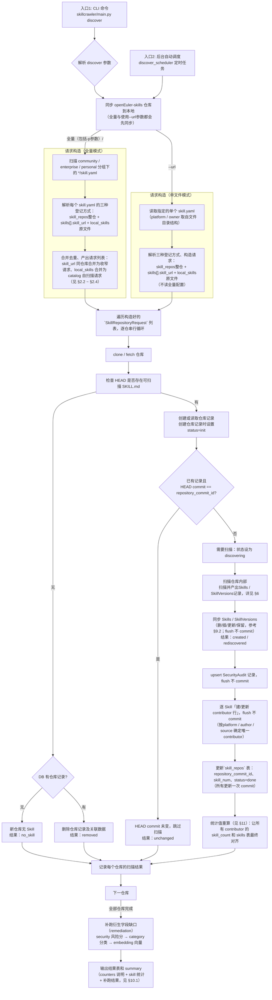
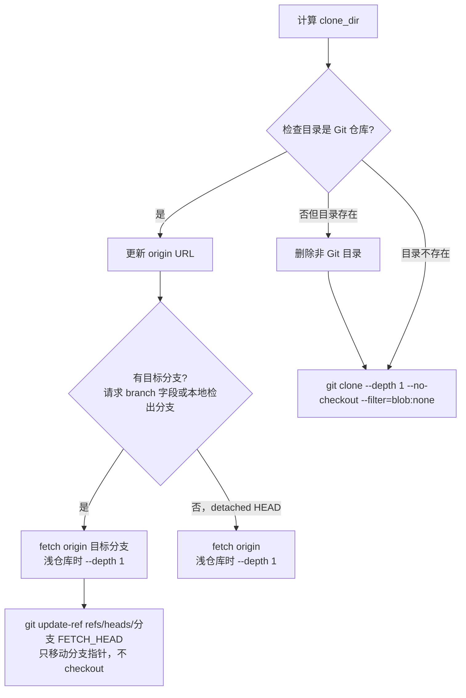
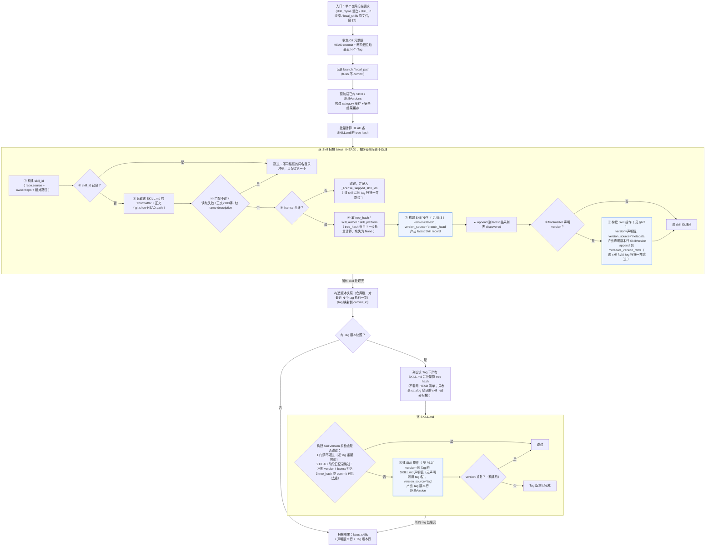
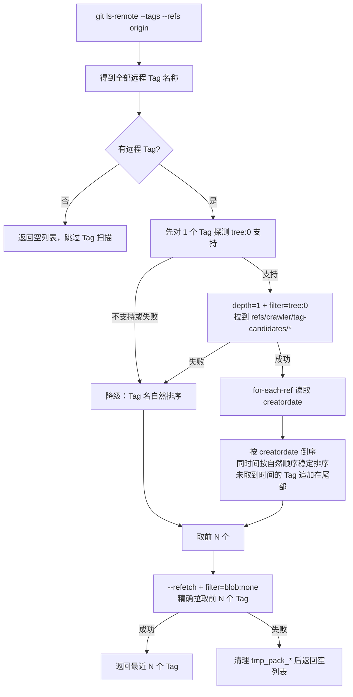
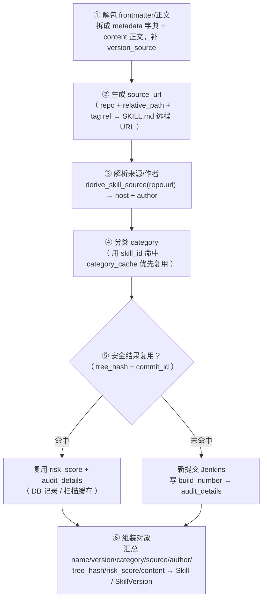
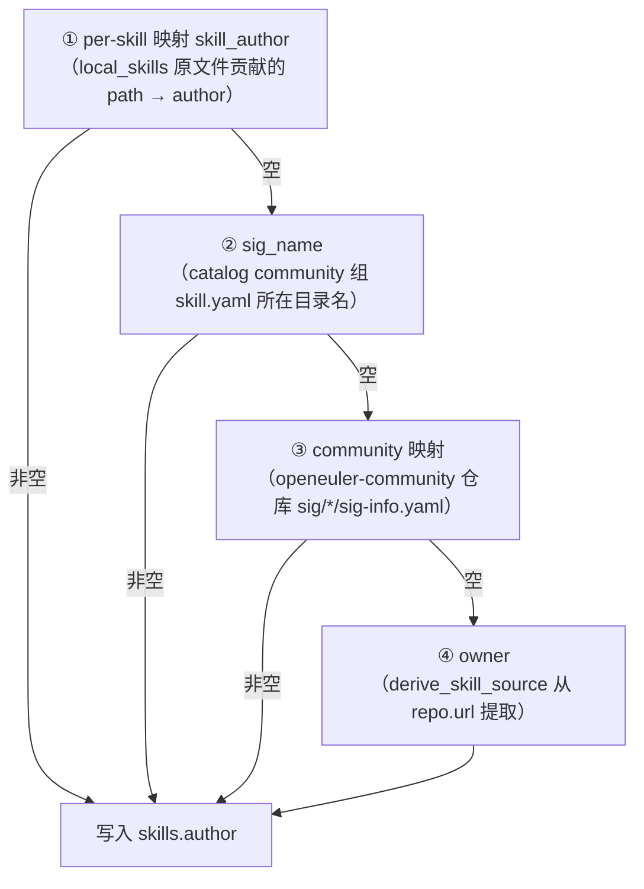
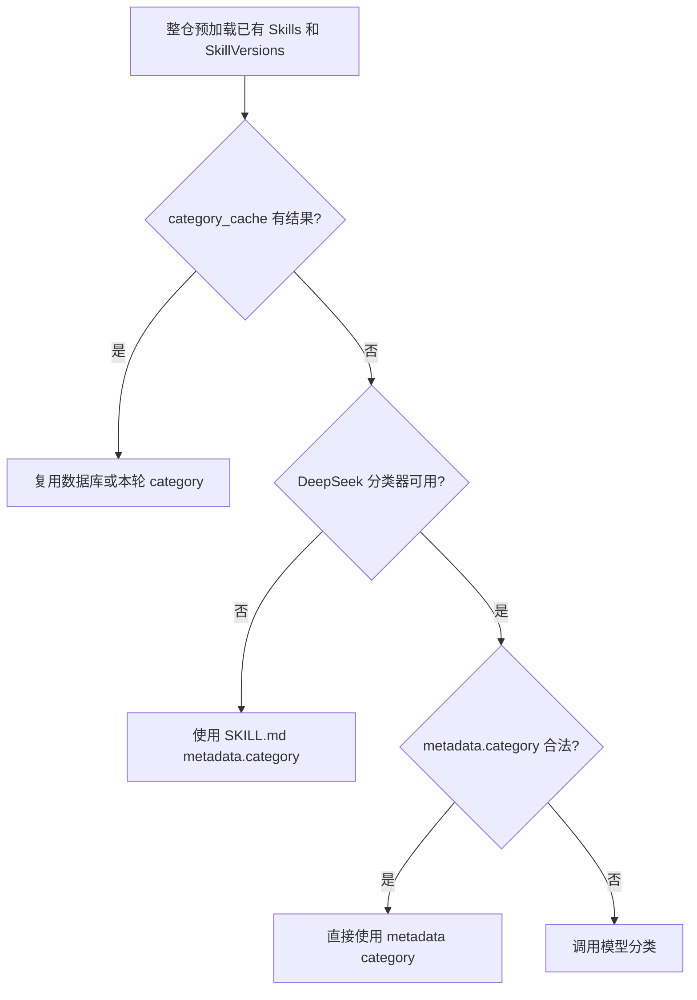
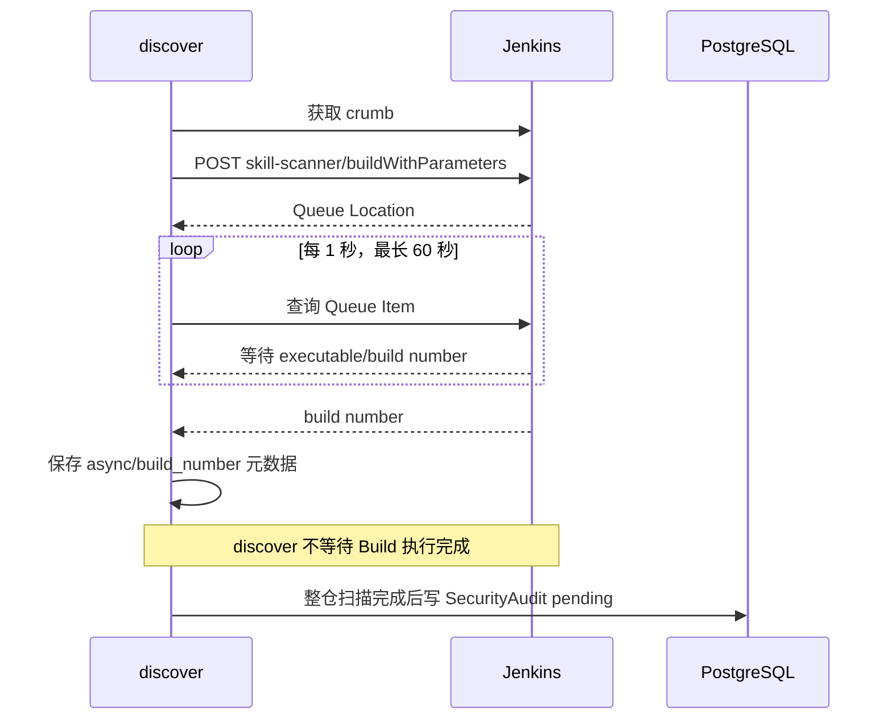
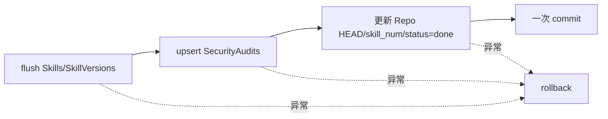

# `skill discover` 流程
本文档基于当前仓库代码，说明 discover 流程的完整执行逻辑。

# 章节介绍
| 序号 | 章节 |
|---|---|
| [§1](#1-总体流程) | [总体流程](#1-总体流程) |
| [§2](#2-openeuler-skills仓库) | [openEuler-skills仓库](#2-openeuler-skills仓库) |
| [§3](#3-git-仓库同步) | [Git 仓库同步](#3-git-仓库同步) |
| [§4](#4-仓库级短路分支) | [仓库级短路分支（no_skill / removed / unchanged）](#4-仓库级短路分支no_skill--removed--unchanged) |
| [§5](#5-可扫描-skill-规则) | [可扫描 Skill 规则](#5-可扫描-skill-规则) |
| [§6](#6-skill-与-skillversion-扫描和构建) | [Skill 与 SkillVersion 扫描和构建](#6-skill-与-skillversion-扫描和构建) |
| [§7](#7-category-分类) | [Category 分类](#7-category-分类) |
| [§8](#8-skillspector-安全检测) | [SkillSpector 安全检测](#8-skillspector-安全检测) |
| [§9](#9-数据库写入时机) | [数据库写入时机](#9-数据库写入时机) |
| [§10](#10-仓库状态和结果类型) | [仓库状态和结果类型](#10-仓库状态和结果类型) |
| [§11](#11-删除与统计值重算) | [删除与统计值重算](#11-删除与统计值重算) |
| [§12](#12-错误处理和退出码) | [错误处理和退出码](#12-错误处理和退出码) |


# 1. 总体流程
入口有两种：
## CLI 命令：
```bash
python skillcrawler/main.py discover
```
> 命令用法、参数和示例见 [`skillcrawler/README.md`](../../skillcrawler/README.md)。

## `discover_scheduler` 定时任务
独立worker服务内置 `discover_scheduler` 定时任务，每天固定触发一轮 discover。



## 1.1 关键代码索引

| 模块 | 作用 |
|---|---|
| `skillcrawler/main.py` | CLI 参数、模式路由、逐仓库循环、结果汇总 |
| `src/skills/config.py` | openEuler-skills catalog 与仓库列表加载 |
| `src/skills/skill_manager.py` | 仓库同步、状态、扫描与存储编排 |
| `src/utils/git_operations.py` | clone、fetch、Tag 两阶段拉取、tree hash、blob 物化 |
| `src/skills/skill_parser.py` | SKILL.md 查找、跳过规则、URL/ID 辅助逻辑 |
| `src/skills/skill_scanner.py` | latest/Tag 扫描、分类、安全检测触发 |
| `src/ai/category_classifier.py` | Category 规则和模型调用 |
| `src/models/repository.py` | Skills、SkillVersions、SecurityAudit 持久化 |
| `src/security/detector.py` | Jenkins 客户端和后台报告 collector |
| `src/jobs/worker.py` | 独立 worker 进程中启动和停止 collector |

## 1.2 SkillManager 调用链

```
discover_configured_skill_repository(request)            # 主入口
├── _sync_git_repository(clone_dir, ...)                 # clone / fetch 仓库
│   ├── update_existing_repository()（已克隆）或 clone_repository()（新克隆）
├── _list_skill_paths(clone_dir)                         #  发现 SKILL.md
│   ├── request.skill_paths 非空 → skill_path_filter 收窄，只保留登记的 SKILL.md
│   └── 空 → 查 DB 删除记录 / 返回 None
├── _get_or_create_skill_repository(request, repo_name)  # 查 DB 或新建记录
├── _is_commit_unchanged(repo, clone_dir)                # 对比commit_id
│   └── 未变 → 标记 _unchanged 返回                        # 衍生字段缺口由 remediation 全局兜底
└── 已变 → _discover_and_store_skills(...)                # 扫描并存储（透传 skill_paths / skill_path_filter）

_discover_and_store_skills()
├── _discover_skills()                                      # 扫描并返回 Skill/SkillVersion 列表
├── _count_unique_skills(latest_skills)                     # 去重计数
├── skill_repository.store_skills_and_versions(...)         # skills/skill_versions表入库
├── _store_to_security_audits()                             # security_audits表upsert
└── update_skill_repository(DONE, commit_id, skill_num)     # skill_repos表更新状态、skill_num

_discover_skills()
├── git_ops.collect_repository_git_metadata(...)         # 获取仓库最新commit_id和Tag的commit_id
│   ├── get_repository_head_commit_id()                     # 获取 HEAD commit_id
│   ├── _get_repository_latest_tags()                       # 获取最近 N 个 Tag
│   ├── _get_git_ref_commit_id(per tag)                     # 获取tag的commit_id
├── update_skill_repository(branch, local_path)             # skill_repos表更新branch、local_path
└── scanner.start_scan(...)                              # 开始扫描 Skills / SkillVersions
```

## 1.3 SkillScanner 扫描层

```
start_scan(..., skill_paths, skill_path_filter)          # skill_paths 已在上游按 skill_path_filter 收窄
├── load_scan_records(repo.id)                           # DB：已有 skills + versions
├── _scan_latest_skills(skill_paths, ...)                # 只扫上游传入的 skill_paths（部分扫描时已收窄）
│   ├── get_skill_tree_hashes(..., 'HEAD')               # 1 次批量 rev-parse
│   └── per skill：git show → build_skill_id → 分类 → 确定安全检测结果（优先复用）
└── _scan_tagged_skills（per tag）
    ├── list_skill_paths_for_ref(..., ref)               # 1 次 ls-tree -r 独立发现该 Tag 的 SKILL.md
    │   └── skill_path_filter 非空 → 只保留登记的 SKILL.md（部分扫描）
    ├── get_skill_tree_hashes(..., ref)                  # 1 次批量 rev-parse
    └── per skill：git show → 分类 → 确定安全检测结果（优先复用）
```

# 2. openEuler-skills仓库
## 2.1 触发入口
触发方式有两种：CLI 命令和后台定时任务, 触发后skill都来源openEuler-skills仓库

- 先同步`https://atomgit.com/openeuler/openEuler-skills` 到
`<storage.local_path>/skill-repositories/openEuler-skills`，  
扫描其中 `community`、`enterprise`、`personal` 分组下的 `*/skill.yaml`。
- 从skill.yaml解析discover请求：入口**build_configured_discover_requests**，
  收集三种贡献方式：

  | 贡献方式 | 登记内容 | 指向仓库 | 扫描方式 |
  |---|---|---|---|
  | `skill_repos` 整仓贡献 | 整个 git 仓库（§2.2） | 任意外部仓库 | 整仓扫描（`skill_paths=None`） |
  | `skills[].skill_url` 单 Skill URL 贡献 | 单个 SKILL.md 的 `/blob/` URL（§2.3） | 任意外部仓库 | 收窄扫描（`skill_paths` 只录登记清单） |
  | `local_skills` 原文件贡献 | skill 名（原文件，§2.4） | openEuler-skills 自身 | 收窄扫描 + 归属映射覆盖 |

**catalog 结构与配置格式**：catalog 即 [`openEuler-skills`](https://atomgit.com/openeuler/openEuler-skills)
仓库，目录结构为 `openEuler-skills/{community,enterprise,personal}/*/skill.yaml`——
每个平台分组下按 owner（SIG / 企业 / 个人）建目录，目录内放 `skill.yaml` 登记该
owner 的三种贡献。配置格式以 openEuler-skills 仓库的真实 `skill.yaml` 为准。

### 2.1.1 CLI 命令方式触发
`python skillcrawler/main.py discover`，扫描全部仓库，收集增量skill。 
> 命令示例和参数约束见 [`skillcrawler/README.md`](../../skillcrawler/README.md)。

| 命令 | 仓库来源 | commit 未变化时是否跳过 | 说明 |
|---|---|---:|---|
| `discover` | 配置文件 | 是 | 默认模式，全部平台 |
| `discover -p enterprise` | 配置中的指定列表 | 是 | 只读取指定平台列表 |
| `discover --url <path-to-skill.yaml>` | 单个 skill.yaml | 是 | 只扫描该文件登记的 `skill_repos` / `skills[]` / `local_skills`，不读全量配置 |

#### 关于`--url` 单文件模式
- 使用 `--url` 单文件模式时，只构建指定 skill.yaml 登记的请求，包含这个skill.yaml里所有 `skill_repos` / `skills[]` / `local_skills` 三种
- 入口[discover_requests.py `build_requests_from_skill_yaml`](../../src/skills/discover_requests.py#L140-L182)）
- `platform` / owner 取自文件目录结构 `<catalog>/<platform>/<owner>/skill.yaml`（不再由 URL 推断）
- `<path-to-skill.yaml>` 路径先当作本地文件直接解析；如果是相对路径，就拼到openEuler-skills仓库根目录（由`-r` 指定，或未指定时默认路径）
- 文件名必须恰好是`skill.yaml` 且位于三个平台分组之下，否则抛 `ValueError`

### 2.1.2 后台`discover_scheduler` 任务触发  
独立 worker 进程内置的 `discover_scheduler` 定时任务（每天固定时刻 + 服务启动首轮）,
与 CLI 共用同一 `build_configured_discover_requests` /`discover_configured_skill_repository` 执行路径。  

### 2.1.3 discover扫描结束
discover扫描结束后，补跑衍生字段缺口（`_run_remediations_safe()`），并写入`discover-<时间戳>.json` 结果文件。

## 2.2 贡献方式一：`skill_repos` 整仓贡献

本节描述读取实现（[config.py `load_crawler_config`](../../src/skills/config.py#L64-L92)）：

1. 加载结果为 `{"community": [...], "enterprise": [...], "personal": [...]}` 三组列表；
2. 每组的每个 `skill.yaml` 贡献其 `skill_repos` 条目；
3. 按目录顺序（`sorted(root.glob("*/skill.yaml"))`）遍历；
    损坏的 YAML 跳过并 warning、不中断整体读取；
4. 构造请求时校验每个条目必须包含非空 `url`，非法条目抛 `ValueError`；
5. 读取可选的 `branch`；
6. 跨平台按 URL 去重（同一 URL 在多个分组重复登记也只构建一次请求）；
7. 默认扫描全部平台时允许某个列表为空（warning 后跳过）；
   显式指定 `--platform` 时，对应列表为空同样 warning 后跳过，不产生请求。

仓库请求进入 discover 前会规范化 URL：`gitcode.com` 都会自动转换为`atomgit.com`。

## 2.3 贡献方式二：Skill URL 贡献（`skills[].skill_url`）
`skills[].skill_url` 单 Skill 登记：只贡献某个仓库里某个具体 SKILL.md，不扫描整个仓库。  

实现链路：  
1. 收集：[config.py `load_catalog_skill_url_entries`](../../src/skills/config.py#L95-L116)
   读取各组 `skill.yaml` 的 `skills[]` 条目；`skill_name` / `skill_url` 必填，
   缺失抛 `ValueError`；
2. 解析：[skill_parser.py `parse_skill_md_url`](../../src/skills/skill_parser.py#L42-L67)
   把 `skill_url`（`<repo>/blob/<ref>/<path>/SKILL.md`）拆为
   `(repo_url, ref, skill_path)`。`ref` 取 `/blob/` 后第一段，约定为单段分支名
   （含 `/` 的 ref 无法与路径消歧，不支持），作为 clone 分支；`repo_url` 与
   `skill_repos` 同口径规范化（去 `.git`、gitcode→atomgit）；
3. 合并（[discover_requests.py `_build_requests_from_skill_urls`](../../src/skills/discover_requests.py#L78-L136)）：
   - 同一仓库的多条贡献合并为一个请求，`skill_paths` 取并集（部分扫描按请求
     同步入库，拆成多个请求会互相删掉对方的 skill）；
   - 同仓库多条贡献必须同 `ref`，否则抛 `ValueError`；
   - 仓库已被 `skill_repos` 登记时跳过：整仓扫描已覆盖这些 skill；
4. 收窄扫描：请求 `skill_paths` 非空时，HEAD 与 tag 版本扫描都只收录登记的
   SKILL.md（`skill_scanner.py` 的 `skill_path_filter`），入库同步的删除/更新
   只作用于登记 skill。

**示例**：`community/alice/skill.yaml` 登记同一仓库的两个 skill：

```yaml
skills:
  - skill_name: flutter-md
    skill_url: https://atomgit.com/foo/bar/blob/main/docs/skills/flutter-md/SKILL.md
  - skill_name: dart-md
    skill_url: https://atomgit.com/foo/bar/blob/main/docs/skills/dart-md/SKILL.md
```

两条 URL 指向同一仓库 `atomgit.com/foo/bar`、同 ref `main`，按 `repo_url`
分组合并成**一条**请求（`skill_paths` 取并集）：

```python
SkillRepositoryRequest(
    url="https://atomgit.com/foo/bar",
    branch="main",
    platform="community",   # 由 skill.yaml 所在分组决定，非 skill_url 决定
    sig_name="alice",       # community 分组取 owner（目录名）
    skill_paths=[
        "docs/skills/dart-md/SKILL.md",
        "docs/skills/flutter-md/SKILL.md",
    ],
)
```

`skill_repos` 整仓的 `skill_paths=None` 扫全仓库所有 SKILL.md；本例 `skill_paths`
非空，扫描只收录这 2 个 SKILL.md，仓库内其它 SKILL.md 一律忽略（即把「整仓扫描」收窄成「按登记清单扫描」）。合并成一条而非拆两条，是因为入库同步按「请求 = 仓库」做删/插/更新，拆成两条会互相把对方的 skill 判为「已删除」而误删。

统计与清理：

- `skill_repos.skill_num` 记录该仓库贡献的 latest skill 数量。
  - 整仓贡献（`skill_repos` ）：仓库里有几个 SKILL.md 就算几个，`skill_num` = 全部 SKILL.md 数。
  - 部分扫描只收录登记的 SKILL.md（`skill_path_filter`），因此该值等于「登记的 skill 数」，而非仓库内
  全部 SKILL.md 数。
- 登记的 SKILL.md 从仓库删除后：下次 discover 扫描该仓库，按可扫描规则（§5）在
  HEAD 上找不到任何登记 skill，且数据库已有该仓库记录，走 §4.1 的 `removed` 分支
  ——删除该 `skill_repos` 行；`skills` / `skill_versions` 通过
  `ondelete="CASCADE"` 外键自动级联删除，随后清理本地 clone 目录，并触发一次
  统计值重算（§11.2）重算 `contributors.skill_count` / `skill_repos.skill_num`。

## 2.4 贡献方式三：原文件贡献（`local_skills`）

`local_skills` 是第三种登记方式：skill 原文件直接放在 openEuler-skills 仓库
自身的 `skills/<name>/SKILL.md` 下（不指向外部仓库），由 catalog 仓库直接承载
这些 skill。实现链路：

1. 收集：[config.py `load_catalog_local_skill_entries`](../../src/skills/config.py#L119-L131)
   读取各组 `skill.yaml` 的 `local_skills` 列表（元素为 skill 名），产出
   `{platform, owner, author, skill_name, skill_path}`，其中
   `skill_path = skills/<name>/SKILL.md`；`author` 口径与
   `load_contributor_profiles` 一致（enterprise 取 `organization` 否则 owner，
   community/personal 取 owner）；单文件模式改走
   [`load_local_skill_entries_from_entry`](../../src/skills/config.py#L134-L164)
   从单个 entry 提取，口径一致；
2. 合并（[discover_requests.py `_build_local_skills_request`](../../src/skills/discover_requests.py#L185-L220)）：
   全部 `local_skills` 条目合并为**一条** openEuler-skills 自扫描请求——
   `url=OPENEULER_SKILLS_URL`、`platform=None`、`skill_paths` 取并集；不同作者的
   归属不靠 URL 推断，而通过 `skill_authors` / `skill_platforms`（`skill_path`
   相对路径 → author / platform 映射）逐 skill 覆盖；
3. 归属覆盖：扫描构建 record 时按相对路径查 `skill_authors` / `skill_platforms`
   覆盖默认值——author 优先级为 `skill_authors[path]` > 请求 author > URL 推断
   （`derive_skill_source`）；platform 优先级为 `skill_platforms[path]` > 请求
   `repo.platform`（此处为 None）> SKILL.md frontmatter 的 `platform` 字段；
4. 收窄扫描：`skill_paths` 非空，HEAD 与 tag 扫描同样只收录登记的 SKILL.md，
   与 §2.3 的 `skill_path_filter` 机制一致。

生效范围：全量 discover（默认 / `-p` / 后台调度，入口
`build_configured_discover_requests`）与 `--url <skill.yaml>` 单文件模式
（入口 `build_requests_from_skill_yaml`）都会收集 `local_skills`；单文件模式
从该单个 entry 提取（`load_local_skill_entries_from_entry`），全量则遍历
catalog 全部 entry。

统计与清理：与 §2.3 相同——`skill_num` 只统计登记的 skill，skill 文件从
openEuler-skills 仓库删除后，下次扫描走 `removed` 语义清理。


# 3. Git 仓库同步

## 3.1 本地目录

仓库保存目录为：

```text
<storage.local_path>/skill-repositories/<repo_name>
```

例如：

```text
/opt/wittyhub/skill-repositories/github.com_anthropics_skills
```

`repo_name` 的生成方式：

```text
删除 http:// 或 https://
删除末尾 .git
将 / 替换为 _
```

## 3.2 仓库同步流程



- 新仓库使用浅克隆 + partial clone：`git clone --depth 1 --no-checkout --filter=blob:none`（请求带 branch 时加 `--branch`），仓库从建立之初就只有 commit/tree 元数据，blob 按需拉取，不再执行 unshallow（见 §3.3）。
- 已有仓库先更新 origin URL；有目标分支（请求 branch 字段或本地检出分支）时 `fetch origin <branch>`（浅仓库时加 `--depth 1`），随后 `git update-ref refs/heads/<branch> FETCH_HEAD` 把本地分支指针移到新提交；detached HEAD 等无目标分支场景只执行 `fetch origin`。**全程不 checkout 工作区**——仓库以 `--no-checkout` 建立，后续扫描（`git ls-tree` / `git show`）直接读对象库。
- Git 操作默认最多执行 2 次，单次超时 180 秒；所有 git 子进程注入 `GIT_TERMINAL_PROMPT=0` 等非交互环境变量，无 TTY 时认证提示直接失败而不是挂死。
- GitHub 仓库（且配置了 token）的 clone/fetch：先按原始 URL 执行（含 2 次重试），失败后改用带 token 的 URL（SSH URL 也会转换为 `https://<user>:<token>@github.com/...`）再执行（又含 2 次重试）；token 在异常信息中被掩码。

## 3.3 partial clone 和 `blob:none`

Git 仓库主要包含以下对象：

| 对象 | 内容 |
|---|---|
| `commit` | commit ID、作者、时间和父提交等元数据 |
| `tree` | 某个 commit 对应的目录结构和文件列表 |
| `blob` | 文件的实际内容 |
| `tag` | Tag 信息及其指向的对象 |

普通的完整克隆会下载 commit、tree 和全部 blob。  

discover 克隆仓库使用：
```bash
git clone --depth 1 --no-checkout --filter=blob:none [--branch <branch>] <url> <dir>
```

其中：
- `--depth 1`：浅克隆： 只取目标分支最新一个 commit；
- `--no-checkout`：不展开工作树；Skill 元数据通过 `git show <ref>:<path>` 从对象库读取；
- `--filter=blob:none`：partial clone：只下载 commit（--depth 1又指定最新一个）和tree，blob不下载。

三个参数缺一不可：
- 省略 `--depth 1` 会拉取完整历史（大仓库可达数 GB，如 ClickHouse约 2GB，浅克隆后约 200MB）；
- 省略 `--no-checkout` 会展开与仓库文件总量相同的工作区 （如 PostHog 约 500MB）；
- 省略 `--filter=blob:none` 则需下载全部 blob，下载量与工作区相当。

三者组合后本地通常只占几 MB 的 commit/tree 元数据。

克隆完成后 Git 自动把 `origin` 标记为 promisor remote（写入
`remote.origin.promisor=true` 和 `remote.origin.partialclonefilter=blob:none`）。
后续读取缺失 blob 时 Git 自动向远端按需拉取，例如：

```bash
git show HEAD:skills/example/SKILL.md
```

扫描用到的命令对 Git 对象的依赖：
- `git ls-tree` / `git rev-parse` 只需要tree/commit 对象，在 partial clone 中本地已存在；
- `git show <ref>:<path>` 需要blob，读取时自动触发按需拉取。
- `git ls-tree <ref>` 直接读取 ref 的 tree 对象，始终可用。


并非所有 Git 服务都支持 partial clone filter。服务端不支持时，Git 通常只输出
warning（如 `filtering not recognized by server`）并退化为完整传输，克隆仍能成功，
只是对象下载量变大；Tag 元数据阶段的 `tree:0` 探测会主动识别该 warning 并降级为
Tag 名自然排序（见 §6.2.1）。

### blob 预物化（materialize）

SkillSpector 容器以只读方式挂载缓存目录且无网络访问，扫描前必须把 Skill 路径下的
全部 blob 提前拉取到本地。`materialize_skill_objects` 在爬虫宿主机（缓存可写、
网络可用）执行：

```bash
# 1. 列出 Skill 目录下全部对象
git ls-tree -r --format='%(objectname) %(objecttype)' <ref> -- <skill-path>

# 2. 逐个读取 blob，触发 Git on-demand 懒拉取
git cat-file --batch-check
```

`cat-file --batch-check` 读取缺失 blob 时触发 promisor 懒拉取；结束后校验无
`missing` 对象，否则记录 warning 并返回失败。物化在安全链路中的位置（触发
Jenkins 的前置步骤）与失败时的处理（跳过本次审计、不缓存结果、下轮自动重试）见
[`security-audit-feature-spec.md`](security-audit-feature-spec.md) 3.1.1 节。

### 目录 tree hash

安全结果复用以 Skill 目录的 tree hash 为 key（见 §6.3、§8.1），通过一次批量命令
获取：

```bash
git rev-parse <ref>:<skill-dir-1> <ref>:<skill-dir-2> ...
```

tree hash 只依赖 tree 对象（partial clone 中已存在），不需要下载任何 blob；批量
查询失败时对应目录结果为 `None`，扫描继续。

### 3.4 中断传输与 `tmp_pack_*` 清理

Git 流式接收 pack 数据时，会先把数据写入 `.git/objects/pack/tmp_pack_XXXXXX`，
传输成功后才 rename 为正式 pack 文件并构建索引。如果 fetch 在传输过程中因超时、
网络中断或被 kill 而终止，`tmp_pack_*` 文件会永久残留在磁盘上，且不会被任何
pack 索引引用。对大仓库反复执行失败的 fetch 会让这些孤儿文件累积，浪费磁盘
空间（例如 `/opt/wittyhub/skill-repositories/github.com_clickhouse_clickhouse/.git/objects/pack/tmp_pack_yqbJ9L`）。

代码中需要在以下场景主动清理 `tmp_pack_*`：

| 场景 | 清理位置 | 说明 |
|------|---------|------|
| Tag 元数据或精确拉取失败 | `_cleanup_orphaned_tmp_packs` | `_get_repository_latest_tags` 在两阶段 `git fetch` 抛出 `CalledProcessError` / `TimeoutExpired` 后调用 |
| 其他 fetch 失败 | 当前未统一处理 | 可在排查磁盘占用时手动 `rm tmp_pack_*` |

实现要点（[git_operations.py `_cleanup_orphaned_tmp_packs`](../../src/utils/git_operations.py#L424-L440)）：

- 只匹配 `tmp_pack_*` 前缀，不误删 `pack-*.pack` / `pack-*.idx`；
- 通过 `glob` 列举，逐个 `unlink`，失败时只记录 warning 不抛出；
- 在没有 pack 目录（如全新 clone 之前）时直接返回。

> 注意：清理必须在没有其他 fetch 并发执行时进行，否则可能删除正在写入的 pack。

# 4. 仓库级短路分支（no_skill / removed / unchanged）

## 4.1 仓库没有可扫描 Skill

按 §5 的可扫描规则没有找到文件时：

- 数据库没有仓库记录：返回 `no_skill`。
- 数据库已有仓库记录：删除该仓库数据库记录，返回 `removed`。
- 本地 clone 目录都会保留，便于排查或下次更新。

## 4.2 commit 未变化

对于配置模式和 `--url` 模式，已有仓库会比较：

```text
本地仓库当前 HEAD commit
        vs
数据库 repository_commit_id
```

相同后直接标记 `_unchanged` 返回：

```text
result = unchanged
error  = commit unchanged
```

并跳过：

- Skill 解析；
- 分类调用；
- Jenkins 安全检测；
- Skills/SkillVersions 写入；
- SecurityAudit 更新。

历史版本曾在此分支内联为 `risk_score IS NULL` 的记录重提 Jenkins 检测
（`_retry_unscored_security_audits`，结果 `security_retried`）；现已抽离到
统一补齐框架 [`src/jobs/remediation.py`](../../src/jobs/remediation.py)：
安全补审计改为**全局扫描**所有 `risk_score` 缺口行（不限于本轮扫到且 commit
未变的仓库），在每轮 discover 末尾执行，覆盖面更大、
且与 category / embedding 补齐同构。未评分记录的重试流程（还原 `SKILL.md`
相对路径 → 重新提交 Jenkins → 更新 `extra_metadata.security_audit` →
upsert `security_audits` → 保持 `risk_score=NULL` 等 collector 回填）不变，
见 [`security-audit-feature-spec.md`](security-audit-feature-spec.md) 3.1 节与
3.2 节；触发失败的记录仍保持 NULL，由下一轮补跑重试。

# 5. 可扫描 Skill 规则

只扫描仓库内名为 `SKILL.md` 的文件。

以下目录中的 `SKILL.md` 会被跳过：

```text
template, templates
example, examples
demo, demos
test, tests
fixture, fixtures
docs, doc
archive, archives
legacy
```

判断只针对 `SKILL.md` 之前的目录段。例如：

```text
skills/foo/SKILL.md               扫描
examples/foo/SKILL.md             跳过
skills/foo/tests/SKILL.md         跳过
```

扫描文件按路径排序，因此日志中的 Skill 顺序通常是稳定的。

目录名匹配大小写不敏感（`Template/`、`Docs/` 同样跳过）；文件名匹配为
大小写敏感的**精确** `SKILL.md`（根级 `SKILL.md` 或 `*/SKILL.md`），因此
`PRE-SKILL.md`、`backupSKILL.md`、`_cannbot_SKILL.md` 这类近似文件名**不会**
被扫到，`skill.md` / `Skill.md` 同样不会。

路径合法后还有三道收窄：

- **元数据门禁**：frontmatter 必须同时声明 `name` 与 `description`，
  缺任一字段或值为空的 `SKILL.md` 跳过并告警（不算 skill）；
- **内容门禁**：正文 strip 后不足 100 字符的 `SKILL.md` 跳过（多为占位/桩文件）；
- **skill_id 去重**：同仓库不同路径推导出同一 `skill_id`（目录同名）时，
  只保留排序靠前的第一个，其余跳过并告警。

# 6. Skill 与 SkillVersion 扫描和构建

扫描仓库内部的完整流程（§1 中已简化为单节点）：



## 6.1 latest Skill

当前分支（HEAD）的每个可扫描 `SKILL.md` 会生成一个 `Skill`：

```text
version = latest
version_source = branch_head
commit_id = 仓库当前 HEAD commit（repository_commit_id）
tree_hash = Skill 目录的 tree hash
```

- `commit_id` 直接使用仓库 HEAD commit，单独保存在 `skill_repos.repository_commit_id`；
- `tree_hash` 通过一次批量 `git rev-parse HEAD:<skill-dir> ...` 获取（见 §3.3），批量
  查询失败时对应目录为 `None`，扫描继续；
- 安全结果是否复用按 `tree_hash` 判断（见 §8.1），不再按「目录最后修改 commit」判断。

如果仓库记录没有 branch，会检测当前分支或远端默认分支，并回写数据库。

若 SKILL.md 的 frontmatter 声明了 `version`，除上面的 latest 行外，latest 扫描阶段
还会再生成一条 `skill_versions` 版本行，这里称「声明版本行」（`version_source =
metadata`，版本号取自 frontmatter 声明的 version，而非 `latest`）。该行在扫描 HEAD
时生成，不依赖 Tag 快照：即使仓库没有任何 Tag，也会照常生成。该 skill 后续跳过
tag 扫描，不再以 tag 作为版本来源产生重复版本行。

## 6.2 Tag SkillVersion

Git 元数据优先按 Tag 创建时间选择最近的若干 Tag，数量来自：

```yaml
crawler:
  max_tags_per_repo: 5
```

### 6.2.1 标签拉取流程

为避免 Tag 名自然排序漏掉 `release-final`、`stable-summer` 等不规则新标签，同时避免
对包含大量标签的仓库执行 `git fetch --tags`，标签拉取采用“元数据筛选 + 精确补齐”
的两阶段流程：



各步骤说明：

| 步骤 | 命令 | 作用 |
|------|------|------|
| 列出远程 Tag | `git ls-remote --tags --refs origin` | 只下载 ref 列表，不下载对象；`--refs` 排除 annotated Tag 的 `^{}` peeled 条目 |
| 能力探测 | 对自然排序首个 Tag 执行一次 `depth=1 + filter=tree:0` 精确 fetch | Git 服务不支持 filter 时可能只给 warning 且退出码为 0；代码识别该 warning 并降级，避免直接对全部 Tag 发起无过滤传输。探测最多涉及一个 Tag |
| 元数据拉取 | `git fetch --force --no-tags --depth=1 --filter=tree:0 origin '+refs/tags/*:refs/crawler/tag-candidates/*'` | 探测成功后，全部 Tag 只获取 tip tag/commit 元数据，不获取 tree/blob；使用临时 ref 命名空间，不污染正式本地 Tag |
| 时间排序 | `git for-each-ref --format='%(creatordate:unix) ...'` | annotated Tag 使用 tagger date；lightweight Tag 使用目标 commit 的 committer date；相同时间用自然排序作为稳定次序；未取到 creatordate 的 Tag 追加在排序结果尾部 |
| 残留清理 | `_cleanup_candidate_refs(clone_dir)`（排序开始前执行） | 删除上一轮残留的 `refs/crawler/tag-candidates/*`；残留 ref 会让下一次 `tree:0` fetch 在部分服务端触发 `pack-objects` 断言（Git 客户端 bug） |
| 兼容降级 | `_tag_sort_key(tag)` | 元数据 fetch 或时间读取失败时按 Tag 名自然排序（正则拆分数字段并补零比较，`v10 > v9`），保证不因服务端不支持 `tree:0` 而中断整个仓库扫描 |
| 精确拉取 | `git fetch --force --no-tags --refetch --filter=blob:none origin refs/tags/<t>:refs/tags/<t> ...` | 只为前 N 个 Tag 补齐 commit/tree；`--refetch` 防止 Git 因 commit 已在元数据阶段存在而跳过缺失 tree；需要 Git ≥ 2.36 |
| 失败清理 | `_cleanup_orphaned_tmp_packs(clone_dir)` | Git 流式传输把 pack 写到 `tmp_pack_XXXXXX`，成功后才 rename；超时/中断留下孤儿文件，需主动删除 |

> `creatordate` 是统一排序字段，不是可信发布时间。Git 时间戳可由提交者设置；如果
> 业务以后要求“平台 Release 发布时间”，需要另接 GitHub/GitLab/AtomGit API。

元数据阶段的传输规模主要与 Tag 数量和各 Tag tip commit 数量相关，而不是与仓库
文件总体积相关。即使仓库历史包含大型二进制文件，`tree:0` 也不会在这一阶段下载
目录树或文件 blob。元数据阶段的 `--depth=1` 同时把 refetch 的传输量约束在各 Tag
tip 一层——即使 Tag 指向历史深处的 commit，refetch 后本地也只有每个 Tag 的 tip
commit + tree。该约束依赖元数据阶段成功执行（Tag tip 已写入 shallow 边界）；
探测降级为自然排序的路径下 Tag tip 没有写入 shallow 边界，refetch 传输量由服务端
对 `blob:none` 的支持情况决定，可能退化为拉取完整历史。选中前 N 个 Tag 后，
`blob:none` 只批量补齐扫描所需 tree，实际 `SKILL.md` blob 在 `git show` 时按需
获取。

### 6.2.2 版本快照与扫描

每个 Tag 形成一个版本快照：

```text
ref = tag
version = tag
commit_id = 该 Tag 指向的 commit（tag commit，缺失时回退为仓库 HEAD commit）
version_source = tag
tree_hash = Skill 目录在该 Tag ref 下的 tree hash
```

Tag 扫描还有两个限制：

1. 每个 Tag 通过 `git ls-tree -r --name-only <tag>` 独立列出该 ref 下存在的
   Skill 路径，不复用 HEAD 的路径集合——只存在于历史 Tag、后来被删除或改名的
   Skill 也会作为版本导入。
2. 去重分三级：
   - `(skill_id, tree_hash)` 的**内容去重**发生在记录组装之前，命中即跳过该
     条目，不再执行分类调用与安全审计解析。同一 Skill 在多个 Tag 之间目录内容
     未变（例如仓库只改了 README 后连续打 tag）时，只有内容首次出现的 Tag
     （即最新的 Tag，Tag 按创建时间降序迭代）会构建版本记录，其余旧 Tag 不
     写入 `skill_versions`。即使保留下来的版本与 HEAD 的 latest 行 tree_hash
     相同，也仍保留这一条版本行。
   - `(skill_id, commit_id)` 的 commit 预去重发生在记录组装之前，命中即跳过
     该条目，不再执行分类调用与安全审计解析（多个 Tag 指向同一 commit 时只有
     第一个 Tag 会构建记录）；
   - `(skill_id, version)` 的 version 去重发生在组装之后，因为最终 `version`
     可能由 frontmatter 兜底填充，跨 Tag 会出现最终 version 相同的记录。

## 6.3 单个 Skill 的构建顺序

本节展开 §6 主流程图中「构建 record」节点的内部逻辑，对应 `_build_skill_record`。
主图里用同一样式标出的三个节点——⑦ 构建 latest、⑨ 声明版本行、TSKILL 的 T4
构建 Tag 版本——都进入这一段，仅入参不同（`version` / `version_source` /
`return_skill_model`）。



各步骤做什么、它的输入从哪来、产出流向哪：

| 步骤 | 输入 | 做什么 | 产出 → 去处 |
|---|---|---|---|
| ① 解包组装 | `metadata_content`（方法入参） | 拆成 metadata 字典 + content 正文，补 `version_source` | `merged_metadata` → ④、⑥ |
| ② source_url | `repo` + `relative_path` + `ref` | 拼出该 SKILL.md 的远程 URL | `source_url` → ④、⑥ |
| ③ 来源/作者 | `repo.url` + 入参 `author`/`skill_author` | 提取 `host`，按 `skill_author → author → source_author` 兜底 | `source`、`author` → ⑥ |
| ④ 分类 | `merged_metadata` + `content` + `source_url` + `skill_id` | 判定 `category`，`category_cache` 命中即复用 | `category` → ⑥ |
| ⑤ 安全 | `tree_hash` + `commit_id` + `version` + 已有记录 | 三层复用：DB 记录 → 扫描缓存 → 新提交 Jenkins | `risk_score`、`audit_details` → ⑥ |
| ⑥ 组装 | ①~⑤ 的全部产物 | 汇总字段构造 `Skill` / `SkillVersion` 对象 | record → 返回调用方 `append` |

④ 分类与 ⑤ 安全是两个相对独立的字段计算：彼此之间没有数据依赖（⑤ 不消费 ④ 的
`category`），只是代码里顺序调用，最终都汇入 ⑥。

安全结果复用实为三层（DB 记录 → 扫描级缓存 → 新提交 Jenkins），图中第 ⑤ 步的
「命中 / 未命中」两条分支是其简化视图，完整判定与缓存规则见
[`security-audit-feature-spec.md`](security-audit-feature-spec.md) 3.1 节 与 本文§8.1节。

对象构建完成后返回调用方（扫描循环），由调用方 `append` 到内存列表并输出
`Discovered skill` 日志——该日志只表示已加入内存列表，不表示已经写入数据库。

### 6.3.1 `author` 字段解析链

`author` 最终落库值跨两层解析，前一级为空时才用下一级（skill 层见
[skill_scanner.py:583-584](../../src/skills/skill_scanner.py#L583-L584)，仓库层见
[skill_manager.py:298](../../src/skills/skill_manager.py#L298)）：



①④ 是 skill 层（`_build_skill_record` 内 `author = skill_author or author or
source_author`）的兜底；②③ 是仓库层 `author` 的两级兜底，由
[`_resolve_skill_author`](../../src/skills/skill_manager.py#L768) 实现——
`platform=community` 时查映射，否则返回 `None`。

- ② `sig_name` 来自 catalog community 组 `skill.yaml` 所在目录名（见 §2）
- ③ 只对 `platform=community` 生效，从 openEuler community 仓库缓存构建
  `repo_name → sig_name` 映射（[openeuler_sig.py:22](../../src/skills/openeuler_sig.py#L22)）：
  - community 仓库缓存目录：`/opt/wittyhub/openeuler-community`
  - 扫描 `sig/*/sig-info.yaml` 的 `repositories[].repo`，只读取 `openeuler/<repo>`，
    不读取 `src-openeuler/<repo>`
  - 映射示例：`openeuler/PilotGo-plugin-llmops` → `atomgit.com_openeuler_PilotGo-plugin-llmops` → `sig_name`

# 7. Category 分类

分类优先级：



模型分类调用失败按错误类型分流（`category_classifier.py`）：

- **瞬时故障**（httpx 传输层错误：读超时、连接被重置；HTTP 429 / 5xx）：
  最多重试 `CATEGORY_RETRY_ATTEMPTS=2` 次（间隔 2s）；重试耗尽后**降级**——
  `metadata.category` 经 `_normalize_category` 校验（在类别表内，大小写不敏感，
  归一为标准写法）合法则沿用；非法或缺失则返回 `None`（落库为空，
  下轮扫描重新分类），不中断扫描。网络抖动不再导致整仓回滚。
- **配置 / 凭据类错误**（4xx、响应解析失败等非瞬时异常）：抛出
  `CategoryClassificationError`，保持 fatal 语义。该异常在
  [skill_manager.py](../../src/skills/skill_manager.py) 的 except 块中被捕获后：

1. 当前仓库执行 rollback 并标记为 `failed`（单独 commit）；
2. 如果异常类型是 `CategoryClassificationError`，**直接 `raise` 原异常**（不包装为 `ValueError`），保留 fatal 语义；
3. 其他异常仍包装为 `ValueError(...) from exc` 上抛。

因此 [main.py](../../skillcrawler/main.py) 的 `isinstance(exc, CategoryClassificationError)` fatal 判定能正确识别：
当前仓库标记为 `failed`，停止处理后续仓库，CLI 返回退出码 1。

# 8. SkillSpector 安全检测

安全检测的完整设计（触发条件、Jenkins 交互参数、worker 后台 collector、风险评分与存储
规则）见 [`security-audit-feature-spec.md`](security-audit-feature-spec.md)。本节只
描述 discover 阶段与扫描相关的行为。

## 8.1 discover 阶段

安全检测启用且 Jenkins 配置有效时，新 Skill、目录 tree hash 已变化的 Skill，以及
`risk_score IS NULL` 的 Skill 会触发 Jenkins Job。目录 tree hash 相同且已有非空
`risk_score` 时复用已有结果，不提交新 Job；相同 tree hash 的结果也会在 latest 与
各 Tag 版本之间复用（跨版本 security_cache）。

跨版本复用由扫描级缓存 `security_cache`（`dict[tree_hash → SecurityResolution]`）
实现，在单仓库扫描（latest 与全部 Tag）内共享，解析顺序为：DB 已有评分结果 →
同轮缓存 → 提交新 Jenkins Job（三层复用的完整判定流程见
[`security-audit-feature-spec.md`](security-audit-feature-spec.md) 3.1 节）。
两条关键规则：

- **失败结果不缓存**：Jenkins 审计失败（`risk_score=None` 且非异步 pending）不写入
  缓存，相同内容的后续版本会重新提交重试，避免失败传播；
- **异步模式正确性**：缓存命中时保留 `audit_triggered=True` 与原 `build_number`，
  复用记录仍会写入各自 SecurityAudit 行；结果回来后按 `audit.id` 逐行回填，
  同 `build_number` 的行都能被独立更新。

扫描完成时输出缓存统计（`skill_manager` 记录日志）：

```text
[Discover] scan completed for <repo>: latest_skills=N, tagged_skills=M,
security_cache_hits=X, security_audits_submitted=Y, security_audits_pending=Z
```

各计数器的精确口径（`X + Y` 与 `_resolve_security_result` 调用次数的等式关系、
空跑计入 `Y`、version 后置去重的放大效应）见
[`security-audit-feature-spec.md`](security-audit-feature-spec.md) 3.1.2 节。

是否产生新 Jenkins 任务用 ORM 对象上的两个运行时属性表示，二者都不写入
`extra_metadata`、不持久化：

- `_security_audit_triggered`：本轮真正获得新 build number；
- `_security_audit_attempted`：审计已发起（异步）但触发失败、未拿到 build number。

`_store_to_security_audits()` 的筛选条件是 `_has_new_security_audit()` 或
`_has_attempted_security_audit()`：前者落正常的 pending 行；后者（触发失败）也落一条
`risk_level=unknown`、`build_number` 为空的审计行，保证审计链路故障可观测。触发
成功时，Scanner 已保证 `extra_metadata.security_audit` 中存在本轮的新 build number。



提交参数（`GIT_URL`、`REF`、`SKILL_PATH`、`SCANNERS`）的定义见
[`security-audit-feature-spec.md`](security-audit-feature-spec.md) 第九节。

当前 Jenkins Queue 轮询间隔为 1 秒、最长等待 60 秒（discover 触发阶段的同步等待，只为拿到 build number）。executor 繁忙时，discover 会在这里串行等待 build number。

如果 Jenkins 触发失败：

- 记录日志（异常捕获路径为 warning）；
- 返回的 build number 为 `None`；
- Skill 仍会继续构建和入库；
- 仍会落一条 `risk_level=unknown`、`build_number` 为空的 SecurityAudit 行（见上
  `_has_attempted_security_audit`）；collector 拉取后因缺 build_number 跳过，该行
  会久留 pending、无法被回填收集。

本轮写入的 pending `SecurityAudit` 由 worker 侧后台 collector 异步回填，独立于
discover 扫描流程；收集流程（collector 后台轮询周期 120 秒、Build 终态处理、report 下载重试，最多
3 次报告下载重试）见
[`security-audit-feature-spec.md`](security-audit-feature-spec.md) 3.2 节。discover
一轮结束后，只要 worker 正常运行，collector 仍可继续收集报告。

# 9. 数据库写入时机

单个仓库的扫描结果先保存在内存中：

```text
latest_skills: list[Skill]
tagged_skills: list[SkillVersion]  # 声明版本行(metadata) + tag 版本行(tag) 的并集
```

扫描开始时先用两次查询一次性加载本仓库已有的 `skills` 和 `skill_versions`，用于
category、安全结果和版本复用；不再为每个 Skill 单独查询已有记录。只有 latest 和
Tag 全部扫描完成后，才调用：

```python
store_skills_and_versions(
    repo.id, latest_skills, tagged_skills, commit=False,
)
```

因此：

- 中途看到 `Discovered skill` 时，新数据尚未落库。
- 当前仓库扫描中途按 `Ctrl+C`，本轮新 Skill 数据不会写入。
- 已经提交给 Jenkins 的 Build 不会因数据库事务回滚而撤销；中途退出可能留下没有对应 `security_audits` 记录的孤立 Build。
- 当前仓库扫描中途异常，旧 Skill 数据通常仍保留。
- 多仓库模式是每个仓库完成后分别提交，不需要等所有仓库完成。

## 9.1 数据模型约定

discover 写入路径涉及三张关键表，字段约定如下，供 §10 仓库状态和后文更新规则对照。

### `skill_repos`

`skill_repos` 记录一个 Git 仓库的 discover 状态。

| 字段 | 含义 |
|------|------|
| `repo_name` | 由仓库 URL 生成的本地唯一名称，如 `atomgit.com_openeuler_skillhub-cli` |
| `source` | 仓库来源，如 `atomgit` / `github` |
| `platform` | 平台分类，如 `community` / `enterprise` / `personal` |
| `branch` | 当前扫描分支 |
| `url` | Git 仓库 URL |
| `local_path` | 本地 clone 绝对路径 |
| `repository_commit_id` | 仓库 HEAD commit，用于判断 repo 是否更新 |
| `skill_discover_status` | `init` / `discovering` / `done` / `failed` |
| `skill_num` | 当前 repo 下 latest skill 数量 |

### `skills`

`skills` 保存前端展示和下载时使用的 latest skill。

| 字段 | 含义 |
|------|------|
| `skill_id` | 全局唯一 Skill ID，格式类似 `atomgit:openeuler/skillhub-cli/find-skills` |
| `skill_repo_id` | 所属 `skill_repos.id` |
| `commit_id` | 仓库 HEAD commit（= `skill_repos.repository_commit_id`），不是 skill 文件夹独立 commit |
| `platform` | 三级链：per-skill `skill_platform` → `skill_repos.platform` → frontmatter `platform` |
| `author` | SIG 名或仓库 owner，四级解析链见 §6.3.1 |

> 注意：repo HEAD commit 存在 `skill_repos.repository_commit_id`，不要写入
> `skills.extra_metadata.repository_commit_id`。

### `skill_versions`

`skill_versions` 保存 tag 扫描得到的版本快照。每次扫描会重建当前 repo 的版本快照
（见 §9.2）。

## 9.2 增量同步规则（latest Skill 与 Tag 版本通用）
`skills`（latest Skill，按 `skill_id` 定位）与 `skill_versions`（Tag 版本，按
`(skill_id, version)` 定位）共用同一套落库逻辑，先按「技能目录内容是否变化」决定
增量操作：内容相同则跳过更新，内容变化才更新。判定依据：

- 优先比较技能目录 `tree_hash`；
- 任一方缺少 `tree_hash` 时，回退比较 `commit_id`。

具体操作（对 Skill 与 SkillVersion 均适用）：

1. 数据库存在、本次扫描结果不存在的记录 **删除**。
2. 本次新增的记录 **插入**。
3. 内容相同的记录 **跳过**。
4. 内容变化的记录在原记录上**更新**：
   - 刷新 `updated_at`
   - 清空旧的 embedding 与 `last_indexed_at`
   - 保留 `download_count`
   - `risk_score` 写扫描实得值（内容变化重新触发审计，异步未回时为空，由收集器稍后回填，不复用旧分）。

**安全结果复用**（latest 与 tag 通用）发生在持久化之前：扫描器读取已有版本记录，
当 `tree_hash` 相同且已有评分时，复用原 `risk_score` 和 audit metadata，避免重复触发
安全扫描；相同内容还可通过本轮基于 `tree_hash` 的安全结果缓存跨 latest 和 tag 版本
复用。

## 9.3 提交边界

单仓库成功写入的事务边界为：



branch 和 local_path 在扫描前以 `commit=False` 更新（只 flush 不提交）；随后
`start_scan` 开头的 `load_scan_records` 末尾会 commit 并把它一并提交，故这两者
不随最终 Repo 更新一起提交。除此之外，
Skills、SkillVersions、本轮新 SecurityAudit，以及 Repo 的最终 HEAD、数量和 done
状态要么一起成功，要么一起回滚。开始前写入的 `discovering` 状态和失败后的
`failed` 状态仍各自单独提交，以便外部观察任务状态；统一补齐
（[`src/jobs/remediation.py`](../../src/jobs/remediation.py)）是扫描
结束后的独立短事务批次，不进入本事务。

写入 `security_audits` 有两种情况：① 运行时 `_security_audit_triggered=true` 且获得
新 Jenkins build number 的记录（写入/重置审计）；② `_security_audit_attempted=true`
（审计已发起但触发失败、未拿到 build number）也落一条 `risk_level=unknown` 的记录，
保证审计链路故障可观测。

# 10. 仓库状态和结果类型

仓库状态：

| 状态 | 含义 |
|---|---|
| `init` | 仓库记录刚创建 |
| `discovering` | 正在扫描 |
| `done` | 扫描和存储完成 |
| `failed` | 扫描流程发生异常 |

skill仓库扫描结果：

| result | 含义 |
|---|---|
| `created` | 新建仓库记录并完成扫描 |
| `rediscovered` | 已有仓库 commit 变化并完成重扫 |
| `unchanged` | HEAD commit 与数据库相同，跳过扫描 |
| `removed` | 已有仓库不再包含可扫描 Skill，删除 DB 仓库记录 |
| `no_skill` | 新仓库没有可扫描 Skill，不创建 DB 仓库记录 |
| `failed` | 当前仓库处理失败 |

> 前五个结果由 `classify_discover_result` 映射；`failed` 由仓库循环的异常分支直接计入
> counters，不经 `classify_discover_result`。

## 10.1 每轮结果文件输出

自动调度每轮结束把结果写入 `result_dir`（默认 `<storage.local_path>/logs`）下的
`discover-<时间戳>.json`，结构如下（实现见 [`src/jobs/discover_scheduler.py`](../../src/jobs/discover_scheduler.py)）：

| 字段 | 说明 |
|---|---|
| `counters` | 仓库级统计，各项含义见下表（与 §10 结果类型口径一致） |
| `skill_stats` | skill 级统计（口径：`skills` 表 latest Skill，不含 Tag 版本） |
| `remediation_run` | 本轮补齐三类衍生字段缺口的执行结果（`security` / `category` / `embedding`），见 §10.1.3 |
| `repos` | 每仓明细：`url` / `outcome` / `skill_num` / `duration_seconds`，失败仓另含 `error` |

除上表四个聚合对象外，顶层还含标量字段 `started_at` / `finished_at` / `total_repos` /
`config_keys` / `total_seconds` / `avg_seconds_per_repo` / `slowest_repos`。

`counters` / `skill_stats`（含 `security_audit`、`index_creation` 子对象）/
`remediation_run`（各任务子对象）的每个字段均内嵌 `<key>_note` 文字说明
（如 `created` → `created_note`），随文件输出便于离线解读：

### 10.1.1 counters 各项含义

| 项 | 说明 |
|---|---|
| `created` | 新建仓库记录并完成扫描 |
| `rediscovered` | 已有仓库 commit 变化并完成重扫 |
| `unchanged` | HEAD commit 与数据库相同，跳过扫描 |
| `removed` | 已有仓库不再包含可扫描 Skill，删除 DB 仓库记录 |
| `no_skill` | 新仓库没有可扫描 Skill，不创建 DB 仓库记录 |
| `failed` | 当前仓库处理失败（clone/fetch 或扫描异常），详见 `repos[].error` |

### 10.1.2 skill_stats 结构

| 字段 | 说明 |
|---|---|
| `total_skills` | skills 表 Skill 总数 |
| `category_distribution` | 分类分布 `{category: count}`，按数量降序；NULL / 空 / `other` / `others` 统一归入 `others` |
| `security_audit.audited` | 安全检测完成（`risk_score` 非空）的 Skill 数 |
| `security_audit.pending` | 异步检测进行中（`skillspector_async` 为 true、`skillspector_collected` 为空且 `risk_score` 为 NULL）的 Skill 数 |
| `security_audit.failed` | 安全检测失败：`risk_score` 为空且无异步检测进行中（触发失败或终态无报告） |
| `security_audit.failed_skills` | 失败明细（`skill_id` / `name` / `source_url`），最多 50 条，超出由 `failed_skills_truncated` 标记 |

### 10.1.3 补齐结果（remediation_run）

`remediation_run` 是本轮补跑衍生字段缺口（§1 流程图 Y2 节点）的执行结果，
含 `security` / `category` / `embedding` 三个任务各自的统计（实现见
[`src/jobs/remediation.py`](../../src/jobs/remediation.py)）：

| 任务 | 正常执行输出 | 跳过/异常输出 |
|---|---|---|
| `security` | `SecurityBackfillStats.as_dict()`：`total` / `triggered` / `failed` / `skipped` | 锁占用 → `{"skipped":"..."}`；检测关闭 / skillspector 不可用 → 完整 `as_dict()`（`skipped` 字段为原因） |
| `category` | `BackfillStats.as_dict()`：`total` / `filled` / `unclassified` / `failed` / `skipped`（见 [`category_backfill.py`](../../src/ai/category_backfill.py)） | 锁占用 → `{"skipped":"..."}`；分类器不可用 → 完整 `as_dict()`（`skipped` 字段为原因） |
| `embedding` | `ReindexStats.as_dict()`：`total` / `indexed` / `failed_batches` / `failed_rows` / `skipped_empty` / `stale_skipped`（见 [`src/ai/embedding_indexer.py`](../../src/ai/embedding_indexer.py)） | 锁占用 / 语义搜索未启用 → `{"skipped":"..."}` |

只有「锁占用」（三个任务）与「embedding 语义搜索未启用」返回裸 `{"skipped":"..."}`；
security/category 的能力不可用返回带 `skipped` 字段的完整统计对象。任务级兜底异常
（三个任务通用）输出 `{"error":"remediation task failed"}`。单任务锁被占用或失败
只记录在该任务的统计里，不影响其余任务执行。

`skill_stats.index_creation` 是索引状态的存量口径（全库），四项为互斥三分法，
`indexed + missing + not_required` 恒等于 `total`：

| 字段 | 说明 |
|---|---|
| `total` | skills 表 Skill 总数 |
| `indexed` | 已建 embedding 的 Skill 数（不论是否已审计） |
| `missing` | 已审计但 embedding 缺失的 Skill 数（**索引创建失败**，等下轮 discover 补跑自愈） |
| `not_required` | 未审计且未建索引（`risk_score` 与 `embedding` 均为空）的 Skill 数，暂不建索引属预期状态 |

# 11. 删除与统计值重算

删除仓库记录（CLI `delete` 命令、仓库内 SKILL.md 全部消失时的单仓删除）与
扫描落库后的统计值维护（每个仓库扫描完成后执行）。

## 11.1 批量删除

`SkillRepoRepository.delete_skill_repositories(ids)`（`src/models/repository.py`）
是集合式批量删除，整批为 5 条 SQL（2 次 SELECT + 2 次 DELETE 软关联 + 1 次 DELETE
仓库，另加 flush / commit）：

```text
delete_skill_repositories(ids)
├── SELECT skills.id / skill_versions.id                  # 收集两类 UUID
│        WHERE skill_repo_id IN (...)                     #（tag 版本审计同样
│                                                        #  按版本 UUID 落软关联）
├── delete_skill_related_records(resource_ids)            # 批量清软关联表，
│                                                        #   返回清理总行数
│   ├── DELETE security_audits WHERE resource_id IN (...)
│   └── DELETE download_history WHERE resource_id IN (...)
└── DELETE FROM skill_repos WHERE id IN (...)            # 外键 CASCADE 删除
                                                         #   skills + skill_versions
```

- 单条删除 `delete_skill_repository(id)` 委托批量入口（CLI `delete` 命令、
  仓库内 SKILL.md 全部消失时的单仓删除共用同一实现）。
- `security_audits` / `download_history` 通过 `resource_type='skill' + resource_id`
  软关联（无外键），必须显式清理；`security_audits` 对 tag 版本（SkillVersion）
  同样落记录，因此清理集合是 skill 与 skill_versions UUID 的并集。`skills` /
  `skill_versions` 对 `skill_repos` 是 `ondelete="CASCADE"` 外键，删除仓库行时
  自动级联。
- 删除成功后清理本地 clone 目录（`SkillManager._cleanup_local_clone`，失败仅告警）。
- CLI `delete` 命令删除完成后触发一次统计值重算（见 11.2），立即修正
  `contributors.skill_count` / `skill_repos.skill_num`。

批量删除前后输出日志，便于排查线上问题：

```text
Batch delete skill repos: repo_count=N, repo_ids=[...]              # 执行前
Batch delete skill repos done: skill_repos_deleted=N,               # 执行后
    related_skill_count=N, related_records_deleted=N
```

`skill_repos_deleted` 与 `repo_count` 不一致说明有仓库被并发删除；
`related_records_deleted` 明显偏少说明软关联数据本就有缺失。
`related_skill_count` 只统计 skills 表 UUID（不含版本），与上文「并集」口径不同，仅作日志观测。

## 11.2 统计值重算

`_reconcile_skill_statistics()`（`src/skills/skill_manager.py`）按实际数据
重算两处统计值，`WHERE 旧值 <> 新值`，天然幂等（每个仓库扫描完成后、
以及 CLI `delete` 删除仓库后各执行一次）：

- `contributors.skill_count`：字段完备（is_complete）且未下架（is_removed=false）的可见 skill 计数（与查询口径一致）；
- `skill_repos.skill_num`：仓库下的 skill 行数。

修正完成后输出日志 `Discover: statistics reconciled after scan: contributors=N, skill_repos=N`
（两类修正数均为 0 时不输出）；失败仅告警，不影响已提交的扫描结果。

# 12. 错误处理和退出码

| 场景 | 当前行为 | 退出码 |
|---|---|---:|
| 全部成功 | 输出 summary | 0 |
| commit unchanged / no_skill | 视为正常结果 | 0 |
| Jenkins 触发失败 | Skill 继续扫描，安全审计缺失 | 通常 0 |
| 扫描阶段异常（配置批量模式） | rollback + DB 状态设为 failed（单独 commit），记 failed 行，继续下一个仓库 | 1 |
| clone/fetch 异常（配置批量模式） | 异常在 try 块外上抛，DB 状态不更新，记 failed 行，继续下一个仓库 | 1 |
| CategoryClassificationError | rollback + 状态设为 failed（单独 commit），原异常直接上抛，停止后续仓库（见 §7） | 1 |
| 非法命令行参数（argparse，如 `-p` 取值非法、缺子命令） | `parser.parse_args()` 抛 `SystemExit(2)` | 2 |
| 配置错误（构建请求抛 `ValueError`） | 异常上抛到 main 的 `except Exception` | 1 |
| `Ctrl+C` | 记录 Canceled | 130 |

批量模式只要 `failed_count > 0`，最终退出码就是 1；
`CategoryClassificationError` 会额外停止后续仓库（见 §7）。
